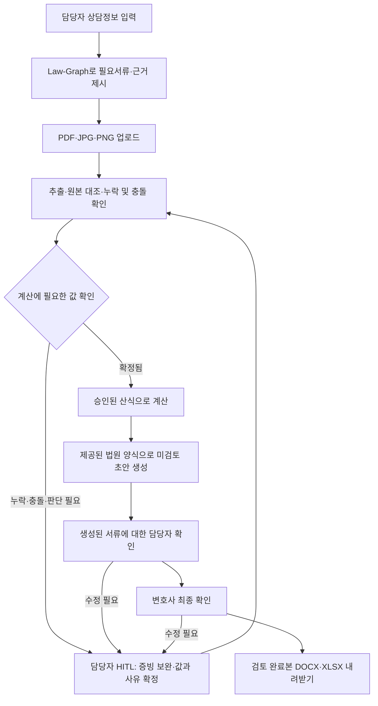

# Law-Graph 기반 필요서류 정의·추출·계산·제출서류 작성 자동화

- 제품: 법무법인용 개인회생 자동화툴 · Firm Engine
- 작성자: 양대성
- 작성일: 2026-10-26
- 상태: grill-me 인터뷰 Q1~Q12 합의 반영. 합격 기준은 1차 검증에 우선 적용한다.
- 근거 문서: [양대성 WhyTree](../whytree/양대성.md), [프로젝트 기획](../PROJECT.md), [상담 질문·기존 합의](../QUESTIONS.md), [종합 프리모텀](../PREMORTEM.md)

## 1. 해결할 문제와 목표

법무법인의 사건 담당자는 상담 내용과 흩어진 증빙에서 필요한 서류를 판단하고, 매출·경비·재산·채무 정보를 반복해서 옮겨 적으며, 계산 결과를 법원 서식에 반영한다. 누락이나 불일치가 발견되면 자료 확인과 문서 수정을 반복한다.

첫 버전은 개인사업자 사건에 대해 **상담정보 입력 → 필요서류 정의 → 서류 추출·대조 → 담당자의 인정값 확정 → 계산 → 실제 법원 양식 기반 초안 생성 → 생성된 서류에 대한 HITL → 검토 완료본 내려받기**를 연결한다.

WhyTree의 ‘필요서류 정확히’, ‘서류 요청/추출/계산’, ‘회생문서 작성’을 구현하여 재확인과 작성 공수를 줄인다. 우선 목표는 동일한 사건의 작성·검토·수정 시간을 기존 방식보다 20% 이상 줄이는 것이다. 법원의 실제 인가 여부를 이번 기능의 성능 지표로 사용하지 않는다.

## 2. 합의한 범위

| 항목 | 결정 |
|---|---|
| 첫 지원 사건 | 개인사업자 사건. 확보한 샘플이 개인사업자 사건이라는 사용자 설명을 기준으로 한다. |
| 최초 관할 전제 | 서울회생법원을 초기 전제로 둔다. 사용자는 개인사업자 유형을 명시했으며, 실제 샘플·제공 양식의 관할을 확인하여 확정한다. 관할이 달라지면 적용 규칙·서식도 함께 맞춘다. |
| 주 사용자 | 법무법인의 사건 담당자. 상담정보 입력, 자료 업로드, 추출값 확인, 초안 검토를 수행한다. |
| 최종 확인 | 생성된 서류를 담당자가 확인한 뒤 변호사가 최종 확인한다. 이상이 없는 사건도 생성 후 HITL을 거친다. |
| 입력 | 구조화된 상담 입력폼과 PDF·JPG·PNG 업로드. |
| Law-Graph | 전문가가 검토한 법령·실무준칙·산식을 연결하고, 필요서류·검증·계산의 적용 근거를 제시한다. |
| 서식 | 사용자가 실제로 받은 법원 요청양식·제공양식을 사용한다. 서식 버전과 항목 매핑은 홍푸른님의 검토를 거친다. |
| 출력 | 편집 가능한 DOCX 서류 초안과 XLSX 계산근거표. 체크리스트·불일치·검토 정보를 함께 제공한다. |
| 사건정보 수명 | 작업 중 임시 세션에서만 유지한다. 명시적 종료 또는 60분간 미사용 시 삭제하며 재접속 복구를 제공하지 않는다. |
| 완료 지점 | 법원에 제출하기 전, 사람이 검토를 마친 최초 신청서류 묶음의 생성·내려받기. |

다음은 후속 범위로 둔다.

- 수임 적격성 판정, 최적 회생전략 자동 결정, 법원 승인 확률 예측.
- 실제 전자소송 제출, 보정권고 대응 및 보정서 작성.
- 의뢰인 직접 접속, 카카오톡·메일 자동 수집, 서류 요청 자동 발송.
- 급여소득자 등 다른 사건 유형으로의 확장과 샘플·승인 규칙으로 검증하지 않은 유형의 자동 처리.
- 사건 DB 축적, 사건정보를 이용한 반복학습, 보정 내역·법원 성향의 자동학습.

WhyTree의 자동학습 루프와 승인 가능성 시뮬레이션은 이번 범위에서 제외한다. 이는 Q1~Q3의 결정이며, 기존 문서의 ‘사건정보 저장·반복학습 제외’ 합의를 유지한다.

## 3. 사용자 흐름과 HITL

작업 상태는 ‘입력 중’, ‘보완·확인 필요’, ‘계산 가능’, ‘미검토 초안 생성’, ‘담당자 확인 완료’, ‘변호사 최종 확인 완료/검토 완료’로 구분한다. 보완이 필요한 항목과 관계없는 추출·계산·초안 작업은 계속할 수 있다.

HITL은 두 지점에서 작동한다.

1. **추출·계산 전후의 확인:** 누락, 서류 간 충돌, 영업소득 인정항목 등 사람이 판단해야 하는 값을 확정한다.
2. **최종 서류 생성 후 확인:** 담당자가 실제 생성된 문서와 근거를 검토하고, 변호사가 최종 확인한다. 입력값 확인만으로 문서 검토를 완료한 것으로 처리하지 않는다.

## 4. 기능 요구사항

### F1. 상담정보와 필요서류 정의 (P1)

- 관할, 사업·과세유형, 사업장·소득 구조, 자료 대상기간, 재산·채무·부양가족 등 서류 판단에 필요한 사실을 입력한다. 미입력·불명확한 정보는 ‘확인 필요’로 유지한다.
- 개인사업자의 업종·과세유형·사건 조건에 따라 필요서류를 조건부로 매핑한다. 모든 개인사업자에게 동일한 필수목록을 적용하지 않는다.
- 각 요청 항목에 서류명, 필요한 이유, 적용 규칙, 필요한 기간·항목, 수취 및 보완 상태를 표시한다.
- 판단에 필요한 상담정보가 부족하면 먼저 확인할 질문과 그 정보에 따라 달라질 서류를 제시한다.
- 사업자등록증, 세무 신고자료, 사업자통장 내역, 소득금액증명 등은 검토할 수 있는 자료의 예시다. 실제 필수목록은 제공 샘플과 승인 규칙을 기준으로 확정한다.
- 제공 양식·샘플의 관할이나 조건이 승인 규칙과 다르면 지원 여부를 확인하도록 표시한다.

### F2. 업로드·추출·원본 대조 (P0)

- PDF·JPG·PNG에서 사업 매출·경비, 재산, 채무와 문서 작성에 필요한 정보를 추출한다. 읽을 수 없는 파일이나 페이지는 담당자가 다시 확인할 대상으로 표시한다.
- 추출 항목마다 원본 파일, 페이지·위치 또는 발췌, 원문 값, 정규화한 후보값, 확인 상태를 연결한다. 생성 문서의 항목에서 원본 근거까지 이동할 수 있어야 한다.
- 채무 원금·이자, 매출·경비, 기간·단위 등 의미가 다른 값은 구분한다. 단순한 계좌 입출금과 영업소득 인정금액을 동일한 값으로 확정하지 않는다.
- 상담 진술과 서류, 서로 다른 서류의 값을 대조한다. 불일치가 있으면 후보값과 양쪽 근거를 함께 보여준다.
- 값이 없다는 이유로 0을 입력하거나 사실을 추정하여 확정하지 않는다. 담당자가 0으로 확정하는 경우에도 근거나 확인 사유를 남긴다.
- 담당자는 증빙 보완, 후보 선택, 값 수정과 인정 여부를 확정할 수 있다. 해당 변경과 사유는 임시 검토 이력에 반영한다.

### F3. 영업소득과 법적 계산 (P0)

- 매출·사업경비를 월별로 추출·대조하고, 담당자가 인정할 항목과 금액을 확정한 뒤 후속 계산에 사용한다.
- 자동화 대상은 월별 영업소득, 가용소득, 청산가치, 변제계획 관련 금액·변제율이다. 개별 계산은 승인된 규칙과 필요한 확정값이 갖춰졌을 때 활성화한다.
- 적용 기간, 수입·경비 인정 기준, 세금 처리, 생계비·공제, 변제기간, 반올림·절사 등은 전문가가 승인한 산식·매개변수 버전으로 관리한다. 변제기간을 일괄 36개월로 고정하지 않는다.
- 같은 확정 입력값과 규칙 버전에는 같은 결과를 내는 계산 로직을 사용한다. AI가 생성한 임의의 숫자를 최종 계산값으로 채택하지 않는다.
- 계산근거표에 사용한 입력값과 출처, 대상기간, 적용 산식·규칙 버전, 결과, 남은 확인 항목을 표시한다.
- 필수값 누락·충돌·미확인 항목이 있으면 영향을 받는 계산을 보류한다. 영향을 받지 않는 작업은 진행할 수 있다.

### F4. Law-Graph와 근거 추적 (P0)

Law-Graph는 **법적 근거 → 적용 조건 → 필요한 사실·증빙 → 확정 입력값 → 계산 → 문서 항목**의 관계와 의존성을 관리한다.

| 관리 대상 | 필요한 정보 |
|---|---|
| 법적 근거·실무준칙 | 출처 URL 또는 제공 자료 식별자, 조문·준칙 번호, 발행·시행일, 적용 관할 |
| 규칙·산식 | 식별자와 버전, 적용 조건, 필수 입력값, 계산·검증 내용, 전문가 승인 상태 |
| 서류 요구사항 | 요구 조건, 필요한 항목·기간, 근거 규칙, 확인 상태 |
| 원본·사건 사실 | 문서·페이지 근거, 추출 후보, 담당자 확정값과 사유. 세션 내에서만 유지 |
| 문서 템플릿 | 제공 양식 식별자·버전, 관할, 항목 매핑, 검토 상태 |
| 산출물 | 입력·규칙·템플릿·생성 버전, 생성시각, 확인 상태와 확인자 |

- 사건 결과와 영업소득 인정값은 일반 규칙의 전문가 승인과 구분한다. 사건 담당자의 확인이 일반 규칙을 자동으로 변경하지 않는다.
- 검토·승인한 일반 규칙과 템플릿은 재사용할 수 있다. 사건정보와 검토 이력을 규칙 저장소에 축적하지 않는다.
- 원본·입력값·인정금액·규칙·서식이 변경되면 의존관계를 따라 영향을 받는 계산과 문서를 식별한다. 해당 결과의 기존 확인을 해제하고 재계산·재생성·재검토한다.
- 그래프 DB 제품, OCR·AI 모델, MCP 사용 여부는 구현 시 선택한다. 이 명세의 근거 추적·의존성·버전 요구사항을 만족해야 한다.

### F5. 실제 양식 기반 문서 생성·내보내기 (P0)

생성 대상은 다음과 같다. 이는 제품의 생성 범위이며 법정 제출자료 전체를 이 목록으로 한정한다는 뜻이 아니다.

| 산출물 | 형식과 내용 |
|---|---|
| 최초 신청서류 초안 | 개인회생절차개시신청서, 개인회생채권자목록, 재산목록, 수입 및 지출에 관한 목록, 진술서, 변제계획안. 편집 가능한 DOCX로 생성 |
| 계산근거표 | 월별 매출·인정경비·영업소득, 후속 계산의 입력·산식·결과와 근거를 XLSX로 제공 |
| 체크리스트·검토 정보 | 필요서류, 누락·불일치, 미확인 항목, 적용 버전·생성시각·확인자·확인시각을 DOCX/XLSX의 별도 검토표 등으로 제공 |

- 사용자가 실제로 받은 법원 요청양식·제공양식을 기준으로 항목과 표 구조를 매핑한다. 임의로 만든 범용 양식을 최종 기준으로 삼지 않는다.
- 제공된 원본이 HWP·PDF 등 다른 형식이면, 출력에 사용할 DOCX/XLSX 템플릿을 마련하고 전문가가 원본과 대응을 확인한다. 모든 형식에 대한 범용 변환기 개발은 이번 범위에 포함하지 않는다.
- 변환 템플릿, 필드 매핑, 반복되는 채권·재산 행과 합계, 날짜·금액 표시가 원본 양식의 의미와 일치하는지 검증한다.
- 진술서는 제공된 진술과 증빙에 근거하여 작성한다. 확인되지 않은 사실은 확인 항목으로 남긴다.
- 앱에서 원본 증빙과 생성 내용을 대조하는 미리보기를 제공한다. 내려받을 실제 파일의 값·항목·버전과 일치해야 한다.
- 미해결 항목이 있는 작업용 결과도 내려받을 수 있으나 ‘미검토 초안’과 미해결 항목을 명확하게 표시한다. 계산하지 못한 값은 임의로 채우지 않는다.
- 고정 법원 서식에 들어가지 않는 검토 메타데이터는 별도 검토표로 제공한다. 최초 생성부터 최종 확인까지 생성본을 식별할 수 있어야 한다.

### F6. 생성 후 검토와 완료 조건 (P0)

- 담당자는 생성된 서류의 값·서술·표·누락을 원본 및 계산근거와 대조한다. 변호사는 그 결과와 최종 생성본을 확인한다.
- 미확인 필수값·미해결 충돌이 없고, 필요한 규칙·서식이 승인되어 있으며, 해당 생성본에 대한 담당자 확인과 변호사 최종 확인이 있어야 ‘검토 완료’로 전환한다.
- 이상이 자동 탐지되지 않았다는 이유만으로 사람의 확인을 생략하지 않는다.
- 확인자와 역할, 확인시각, 확인한 생성본·규칙·서식 버전을 식별한다. 이 기록은 세션 중 유지하며 내려받는 결과에 포함한다.
- 확인 이후 내용이 바뀌면 영향을 받는 확인을 해제한다. 재생성된 서류에 다시 HITL을 적용한다.
- 이미 내려받은 파일은 앱에서 회수하거나 외부 수정 내역을 추적할 수 없다. 생성시각·버전·검토 상태를 표시하여 구분한다.
- ‘검토 완료’는 앱 내 초안 검토 상태다. 실제 법원 제출·접수·인가를 의미하는 상태는 제공하지 않는다.

## 5. 사건정보의 수명 (P1)

- 업로드 원본, 상담정보, OCR 결과, 추출값, 계산 결과, 생성 문서, 확인 이력은 작업 중 임시 세션에서만 유지한다. 사건 DB와 재접속 복구용 사본을 만들지 않는다.
- 명시적 종료 또는 마지막 사용자 활동으로부터 60분 경과 시 세션을 종료한다. 백그라운드 처리·자동 새로고침이 유휴 시간을 연장하지 않도록 한다.
- 종료 시 서버의 임시파일·메모리·캐시·생성파일·다운로드 임시파일·검토 이력을 삭제하고 다운로드 링크도 만료시킨다. 지연 완료된 작업이 종료된 세션의 자료를 다시 남기지 않도록 한다.
- 연결 종료·오류가 있어도 유휴 시간에 따른 삭제가 작동해야 한다. 종료·시간 초과 뒤에는 기존 작업을 복원하지 않는다. 이 제약을 작업 시작과 종료 전에 안내한다.
- 앱이 관리하는 브라우저의 임시 사건정보도 종료 시 정리하며, 영구 브라우저 저장소에 사건 내용을 저장하지 않는다.
- 사건 내용이 애플리케이션·오류·AI 호출 로그와 추적 기록에 남지 않도록 한다. 사용자가 명시적으로 내려받은 결과물은 사용자 보관 자료로 남는다.
- 외부 OCR·AI를 이용할 경우 해당 서비스의 보관·학습·캐시 정책과 설정도 이 요구사항에 맞는지 검증한다. 앱 내부 삭제만으로 외부 서비스의 삭제까지 검증한 것으로 간주하지 않는다. 정책·설정 확인 전에는 식별 가능한 실제 사건정보를 외부로 전송하지 않는다.
- 법령·일반 규칙·템플릿의 보관은 사건정보 보관과 구분한다. 검증용 샘플을 제품의 학습·영구 저장 대상으로 전환하지 않는다.

## 6. 수용 기준과 검증 계획

### 6.1 기능별 수용 기준

| 상황 | 통과 조건 |
|---|---|
| 지원하는 개인사업자 사건 입력 | 조건에 맞는 필요서류·사유·근거 규칙을 제시한다. 미확인 조건을 확인 대상으로 표시한다. |
| 정상 서류 업로드 | 필요한 값을 추출하고 각 값에서 원본 근거를 확인할 수 있다. |
| 필수자료·값 누락 | 누락 항목과 필요한 보완을 표시하고 해당 계산·검토 완료를 보류한다. 다른 작업은 진행한다. |
| 서류 간 금액 충돌 | 양쪽 값과 근거를 표시한다. 담당자의 근거 있는 확정 전에는 해당 계산·검토 완료를 보류한다. |
| 영업소득 인정값 확정 | 승인된 기간·산식으로 계산하고 전문가가 확인한 기준값과 일치한다. |
| 실제 양식으로 생성 | 합의한 서류 묶음과 근거표가 편집 가능한 DOCX·XLSX로 생성되고 값·표·합계·항목이 검증된다. |
| 최종 초안 생성 | 미검토 상태로 시작한다. 담당자와 변호사가 생성본을 확인해야 검토 완료가 된다. |
| 확인 이후 입력·규칙·서식 수정 | 영향을 받는 계산·문서를 갱신하고 기존 확인을 해제한다. 갱신본에 재검토를 요구한다. |
| 검증되지 않은 유형·규칙 | 자동으로 지원 범위에 포함하지 않고 전문가 확인 대상으로 표시한다. |
| 종료·유휴 60분 경과 | 사건 관련 임시자료와 링크가 제거되고 재접속으로 복원되지 않는다. |

### 6.2 우선 적용할 합격 기준

1. **시간:** 동일한 입력자료와 산출물을 기준으로 작성·검토·수정 시간을 기존 방식 대비 20% 이상 단축한다.
2. **계산:** 검증셋의 확정 입력값에 대한 핵심 계산값이 전문가가 승인한 기준값과 일치한다.
3. **오류 처리:** 준비한 누락·금액 충돌 사례를 탐지하고 해결 전 검토 완료를 차단한다.
4. **사람 검토:** 정상 사건을 포함하여 생성 후 HITL과 변경 후 재검토가 동작한다.

시간은 같은 자료가 준비된 시점부터 최종 검토 완료본을 내려받을 때까지 측정한다. 도구 사용 시 입력·업로드·처리 대기·담당자 확인·수정·변호사 확인·출력을 모두 포함한다. 기존 방식도 같은 업무 범위를 측정한다.

`시간 단축률 = (기존 방식 총 소요시간 - 도구 사용 총 소요시간) / 기존 방식 총 소요시간 × 100`

현재 개인사업자 샘플의 정상 흐름과, 그 구조를 이용한 누락·금액 충돌·입력 수정 변형을 함께 검증한다. 실제 사건 수와 변형 테스트 수를 별도로 기록하고, 지원 유형·자료 기간·기준값·적용 버전을 함께 남긴다. 프리모텀의 ‘약 20세트 확보 가능’은 기존 계획이며, 20세트가 확보되었거나 검증되었다는 의미로 사용하지 않는다.

각 검증 건의 기준답은 구현 결과를 본 뒤 맞추는 방식이 아니라 전문가가 먼저 확인한다. 시간 측정은 가능하면 순서를 교차하고 같은 업무 범위·검토 수준으로 비교한다. 사건 내용을 앱에 축적하지 않고, 필요한 평가 결과는 사용자가 내려받거나 사건 내용을 제외한 집계로 기록한다.

## 7. 구현·검증 전 준비할 자료

인터뷰에서 확정한 기능 범위와 아래 자료의 준비·검증 상태를 구분한다. 이 명세 작성 시 저장소에서 실제 샘플 파일, 제공 양식, 승인 산식은 확인되지 않았다.

| 준비 항목 | 확인 내용과 완료 시점 |
|---|---|
| 개인사업자 샘플 | 사용자가 확보했다고 설명한 샘플의 업종, 과세유형, 사업장·소득 구조, 자료 기간·범위와 관할. 해당 유형 지원 활성화 전 확인 |
| 실제 법원 요청·제공 양식 | 사용자가 받은 원본, 관할·버전과 DOCX/XLSX 출력 템플릿의 대응. 해당 서류 생성 활성화 전 확인 |
| 필요서류 규칙 | 샘플 조건별 요구항목·기간과 법령·실무준칙 근거. 홍푸른님 검토 후 적용 |
| 영업소득 인정 기준·산식 | 대상기간, 인정경비·세금·공제, 청산가치·가용소득·변제계획 계산 기준과 단위·반올림. 전문가 승인 후 적용 |
| 기준 산출물·정답 | 실제 양식으로 작성한 기준본, 핵심 계산값과 누락·충돌 예상 결과. 통합 검증 전 전문가 확인 |
| 시간 비교 자료 | 기존 방식과 도구 사용의 동일 업무 범위·측정 절차. 비교 평가 전 준비 |
| 외부 처리 설정 | OCR·AI를 사용하는 경우 사건정보 수명 요구사항 충족 여부. 식별 가능한 실제 자료 처리 전 검증 |

자료가 준비되지 않은 규칙·서식·사건 유형은 자동화 지원을 활성화하지 않고 확인 필요로 표시한다. 범위를 확대하려면 해당 유형의 자료·규칙·서식과 기준답을 검토하고 지원 범위를 갱신한다.

## 8. 합의 기록

| 질문 | 최종 결정 |
|---|---|
| Q1 | 필요서류 정의부터 최초 제출서류 초안까지. 수임 판정·실제 제출·보정 대응은 후속 범위 |
| Q2 | 전문가 검토 규칙과 근거 추적을 제공하는 Law-Graph. 승인 확률 예측은 후속 과제 |
| Q3 | 사건정보 저장·반복학습 제외. 전문가 승인 일반 규칙만 재사용 |
| Q4 | 최초 제안의 급여소득자를 개인사업자로 변경. 사용자 확보 샘플을 기준으로 진행 |
| Q5 | 사건 담당자의 상담 입력폼과 PDF·JPG·PNG 업로드 |
| Q6 | 누락·불일치에 HITL 적용. 영향 작업만 보류하고 값 확정 후 재계산·재생성 |
| Q7 | 월별 매출·사업경비 대조와 담당자 인정값 확정 후, 승인 산식으로 계산 |
| Q8 | 체크리스트·누락/불일치, 월별 소득·계산근거, 최초 신청서류 6종 초안 생성 |
| Q9 | 임시 세션만 유지. 명시적 종료 또는 60분 미사용 시 삭제. 재접속 복구 없음 |
| Q10 | 실제 받은 법원 양식 사용. 수정 가능한 DOCX·XLSX 출력 |
| Q11 | 최종 서류 생성 후 HITL 필수. 담당자 확인 후 변호사 최종 확인, 변경 시 재검토 |
| Q12 | 시간 20% 단축·핵심 계산값 일치·누락/충돌 탐지 및 차단을 우선 합격 기준으로 적용 |

## 9. 공식 참고자료와 적용 한계

- [채무자 회생 및 파산에 관한 법률 제589조](https://www.law.go.kr/lsLinkCommonInfo.do?chrClsCd=010202&lsJoLnkSeq=1028276157): 신청서 및 첨부서류의 명칭·구성 참고.
- [같은 법 제610조](https://www.law.go.kr/LSW/lsLinkCommonInfo.do?chrClsCd=010202&lsJoLnkSeq=1028273879): 변제계획안 관련 근거 참고.
- [서울회생법원 회생위원 직무편람 제5판](https://slb.scourt.go.kr/rel/information/qna/member_manual.pdf): 2024년 12월 발간 자료. 영업소득 자료와 확인 방식의 참고 자료이며, 수록된 과거 설명을 최신 산식으로 그대로 채택하지 않는다.
- [서울회생법원 민원서식 양식모음](https://slb.scourt.go.kr/rel/information/min/MinListAction.work?pageIndex=1): 서식 확인 경로. 여러 법원의 서식이 함께 표시되므로 관할·버전 확인이 필요하다.

공식 자료의 서류명 확인은 사용자가 제공할 실제 양식의 버전·필드 매핑·산식을 검증한 것과 구분한다. 적용할 법령·준칙·양식은 전문가 검토와 버전 확정을 거쳐야 한다.
