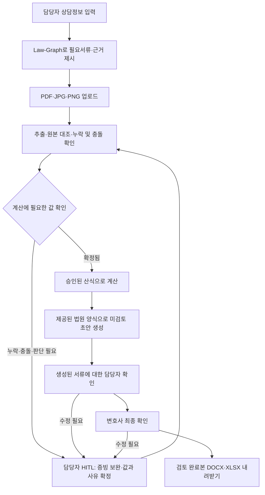
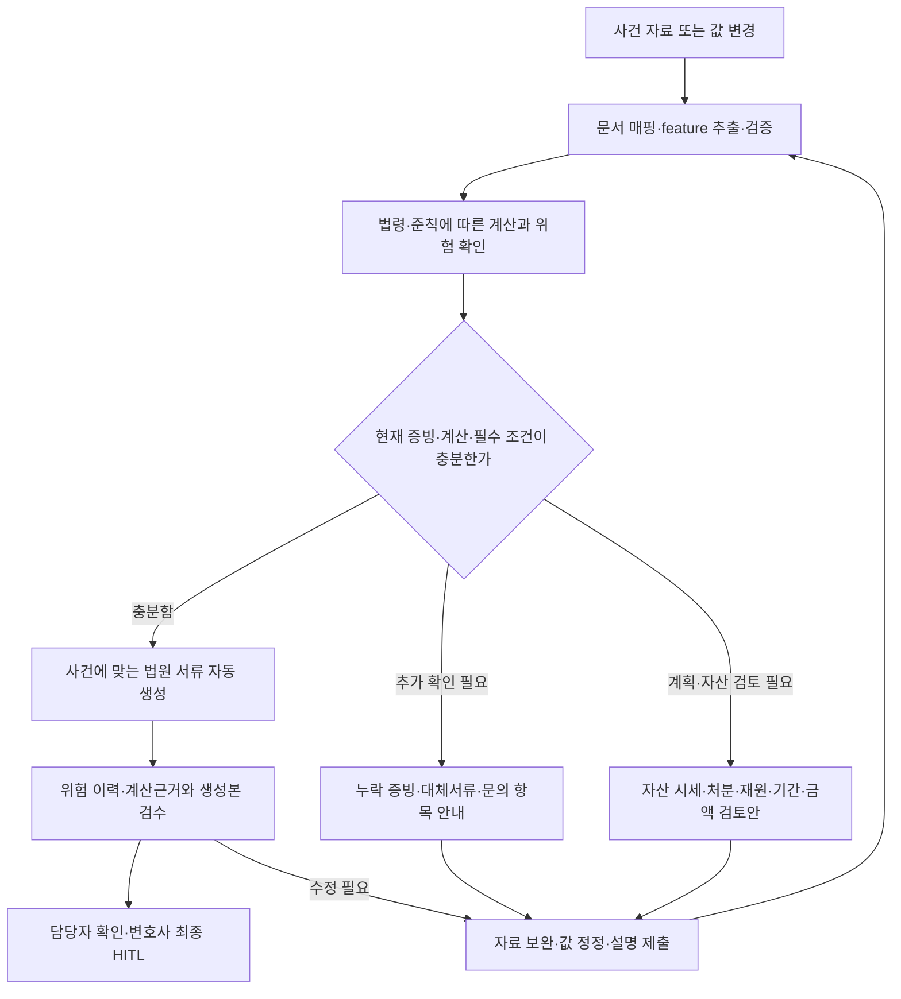

# Law-Graph 기반 필요서류 정의·추출·계산·제출서류 작성 자동화

<!-- amendment-notice:start -->
> **[수정] 후속 요구사항 반영 — 2026-10-26**
> 1~9절은 최초 인터뷰 합의 기록으로 보존한다. 이후 사용자가 추가한 요구사항과 원문을 대체하는 내용은 **10절 `[수정]`**에 정리한다. 상충하는 내용에는 후속 사용자 요구사항을 우선 적용한다. 구현 과정에서 추가된 제한과 미완료 사항은 별도로 표시하며, 이를 사용자가 승인한 요구사항으로 간주하지 않는다.
<!-- amendment-notice:end -->

- 제품: 법무법인용 개인회생 자동화툴 · Firm Engine
- 작성자: 양대성
- 작성일: 2026-10-26
- 상태: grill-me 인터뷰 Q1~Q12 합의 반영. 합격 기준은 1차 검증에 우선 적용한다.
- 근거 문서: [양대성 WhyTree](../whytree/양대성.md), [프로젝트 기획](../PROJECT.md), [상담 질문·기존 합의](../QUESTIONS.md), [종합 프리모텀](../PREMORTEM.md)

## 1. 해결할 문제와 목표

법무법인의 사건 담당자는 상담 내용과 흩어진 증빙에서 필요한 서류를 판단하고, 매출·경비·재산·채무 정보를 반복해서 옮겨 적으며, 계산 결과를 법원 서식에 반영한다. 누락이나 불일치가 발견되면 자료 확인과 문서 수정을 반복한다.

첫 버전은 개인사업자 사건에 대해 **상담정보 입력 → 필요서류 정의 → 서류 추출·대조 → 담당자의 인정값 확정 → 계산 → 실제 법원 양식 기반 초안 생성 → 생성된 서류에 대한 HITL → 검토 완료본 내려받기**를 연결한다.

WhyTree의 ‘필요서류 정확히’, ‘서류 요청/추출/계산’, ‘회생문서 작성’을 구현하여 재확인과 작성 공수를 줄인다. 우선 목표는 동일한 사건의 작성·검토·수정 시간을 기존 방식보다 20% 이상 줄이는 것이다. 법원의 실제 인가 여부를 이번 기능의 성능 지표로 사용하지 않는다.

## 2. 합의한 범위

| 항목 | 결정 |
|---|---|
| 첫 지원 사건 | 개인사업자 사건. 확보한 샘플이 개인사업자 사건이라는 사용자 설명을 기준으로 한다. |
| 최초 관할 전제 | 서울회생법원을 초기 전제로 둔다. 사용자는 개인사업자 유형을 명시했으며, 실제 샘플·제공 양식의 관할을 확인하여 확정한다. 관할이 달라지면 적용 규칙·서식도 함께 맞춘다. |
| 주 사용자 | 법무법인의 사건 담당자. 상담정보 입력, 자료 업로드, 추출값 확인, 초안 검토를 수행한다. |
| 최종 확인 | 생성된 서류를 담당자가 확인한 뒤 변호사가 최종 확인한다. 이상이 없는 사건도 생성 후 HITL을 거친다. |
| 입력 | 구조화된 상담 입력폼과 PDF·JPG·PNG 업로드. |
| Law-Graph | 전문가가 검토한 법령·실무준칙·산식을 연결하고, 필요서류·검증·계산의 적용 근거를 제시한다. |
| 서식 | 사용자가 실제로 받은 법원 요청양식·제공양식을 사용한다. 서식 버전과 항목 매핑은 홍푸른님의 검토를 거친다. |
| 출력 | 편집 가능한 DOCX 서류 초안과 XLSX 계산근거표. 체크리스트·불일치·검토 정보를 함께 제공한다. |
| 사건정보 수명 | 작업 중 임시 세션에서만 유지한다. 명시적 종료 또는 60분간 미사용 시 삭제하며 재접속 복구를 제공하지 않는다. |
| 완료 지점 | 법원에 제출하기 전, 사람이 검토를 마친 최초 신청서류 묶음의 생성·내려받기. |

다음은 후속 범위로 둔다.

- 수임 적격성 판정, 최적 회생전략 자동 결정, 법원 승인 확률 예측.
- 실제 전자소송 제출, 보정권고 대응 및 보정서 작성.
- 의뢰인 직접 접속, 카카오톡·메일 자동 수집, 서류 요청 자동 발송.
- 급여소득자 등 다른 사건 유형으로의 확장과 샘플·승인 규칙으로 검증하지 않은 유형의 자동 처리.
- 사건 DB 축적, 사건정보를 이용한 반복학습, 보정 내역·법원 성향의 자동학습.

WhyTree의 자동학습 루프와 승인 가능성 시뮬레이션은 이번 범위에서 제외한다. 이는 Q1~Q3의 결정이며, 기존 문서의 ‘사건정보 저장·반복학습 제외’ 합의를 유지한다.

## 3. 사용자 흐름과 HITL

작업 상태는 ‘입력 중’, ‘보완·확인 필요’, ‘계산 가능’, ‘미검토 초안 생성’, ‘담당자 확인 완료’, ‘변호사 최종 확인 완료/검토 완료’로 구분한다. 보완이 필요한 항목과 관계없는 추출·계산·초안 작업은 계속할 수 있다.

HITL은 두 지점에서 작동한다.

1. **추출·계산 전후의 확인:** 누락, 서류 간 충돌, 영업소득 인정항목 등 사람이 판단해야 하는 값을 확정한다.
2. **최종 서류 생성 후 확인:** 담당자가 실제 생성된 문서와 근거를 검토하고, 변호사가 최종 확인한다. 입력값 확인만으로 문서 검토를 완료한 것으로 처리하지 않는다.

## 4. 기능 요구사항

### F1. 상담정보와 필요서류 정의 (P1)

- 관할, 사업·과세유형, 사업장·소득 구조, 자료 대상기간, 재산·채무·부양가족 등 서류 판단에 필요한 사실을 입력한다. 미입력·불명확한 정보는 ‘확인 필요’로 유지한다.
- 개인사업자의 업종·과세유형·사건 조건에 따라 필요서류를 조건부로 매핑한다. 모든 개인사업자에게 동일한 필수목록을 적용하지 않는다.
- 각 요청 항목에 서류명, 필요한 이유, 적용 규칙, 필요한 기간·항목, 수취 및 보완 상태를 표시한다.
- 판단에 필요한 상담정보가 부족하면 먼저 확인할 질문과 그 정보에 따라 달라질 서류를 제시한다.
- 사업자등록증, 세무 신고자료, 사업자통장 내역, 소득금액증명 등은 검토할 수 있는 자료의 예시다. 실제 필수목록은 제공 샘플과 승인 규칙을 기준으로 확정한다.
- 제공 양식·샘플의 관할이나 조건이 승인 규칙과 다르면 지원 여부를 확인하도록 표시한다.

### F2. 업로드·추출·원본 대조 (P0)

- PDF·JPG·PNG에서 사업 매출·경비, 재산, 채무와 문서 작성에 필요한 정보를 추출한다. 읽을 수 없는 파일이나 페이지는 담당자가 다시 확인할 대상으로 표시한다.
- 추출 항목마다 원본 파일, 페이지·위치 또는 발췌, 원문 값, 정규화한 후보값, 확인 상태를 연결한다. 생성 문서의 항목에서 원본 근거까지 이동할 수 있어야 한다.
- 채무 원금·이자, 매출·경비, 기간·단위 등 의미가 다른 값은 구분한다. 단순한 계좌 입출금과 영업소득 인정금액을 동일한 값으로 확정하지 않는다.
- 상담 진술과 서류, 서로 다른 서류의 값을 대조한다. 불일치가 있으면 후보값과 양쪽 근거를 함께 보여준다.
- 값이 없다는 이유로 0을 입력하거나 사실을 추정하여 확정하지 않는다. 담당자가 0으로 확정하는 경우에도 근거나 확인 사유를 남긴다.
- 담당자는 증빙 보완, 후보 선택, 값 수정과 인정 여부를 확정할 수 있다. 해당 변경과 사유는 임시 검토 이력에 반영한다.

### F3. 영업소득과 법적 계산 (P0)

- 매출·사업경비를 월별로 추출·대조하고, 담당자가 인정할 항목과 금액을 확정한 뒤 후속 계산에 사용한다.
- 자동화 대상은 월별 영업소득, 가용소득, 청산가치, 변제계획 관련 금액·변제율이다. 개별 계산은 승인된 규칙과 필요한 확정값이 갖춰졌을 때 활성화한다.
- 적용 기간, 수입·경비 인정 기준, 세금 처리, 생계비·공제, 변제기간, 반올림·절사 등은 전문가가 승인한 산식·매개변수 버전으로 관리한다. 변제기간을 일괄 36개월로 고정하지 않는다.
- 같은 확정 입력값과 규칙 버전에는 같은 결과를 내는 계산 로직을 사용한다. AI가 생성한 임의의 숫자를 최종 계산값으로 채택하지 않는다.
- 계산근거표에 사용한 입력값과 출처, 대상기간, 적용 산식·규칙 버전, 결과, 남은 확인 항목을 표시한다.
- 필수값 누락·충돌·미확인 항목이 있으면 영향을 받는 계산을 보류한다. 영향을 받지 않는 작업은 진행할 수 있다.

### F4. Law-Graph와 근거 추적 (P0)

Law-Graph는 **법적 근거 → 적용 조건 → 필요한 사실·증빙 → 확정 입력값 → 계산 → 문서 항목**의 관계와 의존성을 관리한다.

| 관리 대상 | 필요한 정보 |
|---|---|
| 법적 근거·실무준칙 | 출처 URL 또는 제공 자료 식별자, 조문·준칙 번호, 발행·시행일, 적용 관할 |
| 규칙·산식 | 식별자와 버전, 적용 조건, 필수 입력값, 계산·검증 내용, 전문가 승인 상태 |
| 서류 요구사항 | 요구 조건, 필요한 항목·기간, 근거 규칙, 확인 상태 |
| 원본·사건 사실 | 문서·페이지 근거, 추출 후보, 담당자 확정값과 사유. 세션 내에서만 유지 |
| 문서 템플릿 | 제공 양식 식별자·버전, 관할, 항목 매핑, 검토 상태 |
| 산출물 | 입력·규칙·템플릿·생성 버전, 생성시각, 확인 상태와 확인자 |

- 사건 결과와 영업소득 인정값은 일반 규칙의 전문가 승인과 구분한다. 사건 담당자의 확인이 일반 규칙을 자동으로 변경하지 않는다.
- 검토·승인한 일반 규칙과 템플릿은 재사용할 수 있다. 사건정보와 검토 이력을 규칙 저장소에 축적하지 않는다.
- 원본·입력값·인정금액·규칙·서식이 변경되면 의존관계를 따라 영향을 받는 계산과 문서를 식별한다. 해당 결과의 기존 확인을 해제하고 재계산·재생성·재검토한다.
- 그래프 DB 제품, OCR·AI 모델, MCP 사용 여부는 구현 시 선택한다. 이 명세의 근거 추적·의존성·버전 요구사항을 만족해야 한다.

### F5. 실제 양식 기반 문서 생성·내보내기 (P0)

생성 대상은 다음과 같다. 이는 제품의 생성 범위이며 법정 제출자료 전체를 이 목록으로 한정한다는 뜻이 아니다.

| 산출물 | 형식과 내용 |
|---|---|
| 최초 신청서류 초안 | 개인회생절차개시신청서, 개인회생채권자목록, 재산목록, 수입 및 지출에 관한 목록, 진술서, 변제계획안. 편집 가능한 DOCX로 생성 |
| 계산근거표 | 월별 매출·인정경비·영업소득, 후속 계산의 입력·산식·결과와 근거를 XLSX로 제공 |
| 체크리스트·검토 정보 | 필요서류, 누락·불일치, 미확인 항목, 적용 버전·생성시각·확인자·확인시각을 DOCX/XLSX의 별도 검토표 등으로 제공 |

- 사용자가 실제로 받은 법원 요청양식·제공양식을 기준으로 항목과 표 구조를 매핑한다. 임의로 만든 범용 양식을 최종 기준으로 삼지 않는다.
- 제공된 원본이 HWP·PDF 등 다른 형식이면, 출력에 사용할 DOCX/XLSX 템플릿을 마련하고 전문가가 원본과 대응을 확인한다. 모든 형식에 대한 범용 변환기 개발은 이번 범위에 포함하지 않는다.
- 변환 템플릿, 필드 매핑, 반복되는 채권·재산 행과 합계, 날짜·금액 표시가 원본 양식의 의미와 일치하는지 검증한다.
- 진술서는 제공된 진술과 증빙에 근거하여 작성한다. 확인되지 않은 사실은 확인 항목으로 남긴다.
- 앱에서 원본 증빙과 생성 내용을 대조하는 미리보기를 제공한다. 내려받을 실제 파일의 값·항목·버전과 일치해야 한다.
- 미해결 항목이 있는 작업용 결과도 내려받을 수 있으나 ‘미검토 초안’과 미해결 항목을 명확하게 표시한다. 계산하지 못한 값은 임의로 채우지 않는다.
- 고정 법원 서식에 들어가지 않는 검토 메타데이터는 별도 검토표로 제공한다. 최초 생성부터 최종 확인까지 생성본을 식별할 수 있어야 한다.

### F6. 생성 후 검토와 완료 조건 (P0)

- 담당자는 생성된 서류의 값·서술·표·누락을 원본 및 계산근거와 대조한다. 변호사는 그 결과와 최종 생성본을 확인한다.
- 미확인 필수값·미해결 충돌이 없고, 필요한 규칙·서식이 승인되어 있으며, 해당 생성본에 대한 담당자 확인과 변호사 최종 확인이 있어야 ‘검토 완료’로 전환한다.
- 이상이 자동 탐지되지 않았다는 이유만으로 사람의 확인을 생략하지 않는다.
- 확인자와 역할, 확인시각, 확인한 생성본·규칙·서식 버전을 식별한다. 이 기록은 세션 중 유지하며 내려받는 결과에 포함한다.
- 확인 이후 내용이 바뀌면 영향을 받는 확인을 해제한다. 재생성된 서류에 다시 HITL을 적용한다.
- 이미 내려받은 파일은 앱에서 회수하거나 외부 수정 내역을 추적할 수 없다. 생성시각·버전·검토 상태를 표시하여 구분한다.
- ‘검토 완료’는 앱 내 초안 검토 상태다. 실제 법원 제출·접수·인가를 의미하는 상태는 제공하지 않는다.

## 5. 사건정보의 수명 (P1)

- 업로드 원본, 상담정보, OCR 결과, 추출값, 계산 결과, 생성 문서, 확인 이력은 작업 중 임시 세션에서만 유지한다. 사건 DB와 재접속 복구용 사본을 만들지 않는다.
- 명시적 종료 또는 마지막 사용자 활동으로부터 60분 경과 시 세션을 종료한다. 백그라운드 처리·자동 새로고침이 유휴 시간을 연장하지 않도록 한다.
- 종료 시 서버의 임시파일·메모리·캐시·생성파일·다운로드 임시파일·검토 이력을 삭제하고 다운로드 링크도 만료시킨다. 지연 완료된 작업이 종료된 세션의 자료를 다시 남기지 않도록 한다.
- 연결 종료·오류가 있어도 유휴 시간에 따른 삭제가 작동해야 한다. 종료·시간 초과 뒤에는 기존 작업을 복원하지 않는다. 이 제약을 작업 시작과 종료 전에 안내한다.
- 앱이 관리하는 브라우저의 임시 사건정보도 종료 시 정리하며, 영구 브라우저 저장소에 사건 내용을 저장하지 않는다.
- 사건 내용이 애플리케이션·오류·AI 호출 로그와 추적 기록에 남지 않도록 한다. 사용자가 명시적으로 내려받은 결과물은 사용자 보관 자료로 남는다.
- 외부 OCR·AI를 이용할 경우 해당 서비스의 보관·학습·캐시 정책과 설정도 이 요구사항에 맞는지 검증한다. 앱 내부 삭제만으로 외부 서비스의 삭제까지 검증한 것으로 간주하지 않는다. 정책·설정 확인 전에는 식별 가능한 실제 사건정보를 외부로 전송하지 않는다.
- 법령·일반 규칙·템플릿의 보관은 사건정보 보관과 구분한다. 검증용 샘플을 제품의 학습·영구 저장 대상으로 전환하지 않는다.

## 6. 수용 기준과 검증 계획

### 6.1 기능별 수용 기준

| 상황 | 통과 조건 |
|---|---|
| 지원하는 개인사업자 사건 입력 | 조건에 맞는 필요서류·사유·근거 규칙을 제시한다. 미확인 조건을 확인 대상으로 표시한다. |
| 정상 서류 업로드 | 필요한 값을 추출하고 각 값에서 원본 근거를 확인할 수 있다. |
| 필수자료·값 누락 | 누락 항목과 필요한 보완을 표시하고 해당 계산·검토 완료를 보류한다. 다른 작업은 진행한다. |
| 서류 간 금액 충돌 | 양쪽 값과 근거를 표시한다. 담당자의 근거 있는 확정 전에는 해당 계산·검토 완료를 보류한다. |
| 영업소득 인정값 확정 | 승인된 기간·산식으로 계산하고 전문가가 확인한 기준값과 일치한다. |
| 실제 양식으로 생성 | 합의한 서류 묶음과 근거표가 편집 가능한 DOCX·XLSX로 생성되고 값·표·합계·항목이 검증된다. |
| 최종 초안 생성 | 미검토 상태로 시작한다. 담당자와 변호사가 생성본을 확인해야 검토 완료가 된다. |
| 확인 이후 입력·규칙·서식 수정 | 영향을 받는 계산·문서를 갱신하고 기존 확인을 해제한다. 갱신본에 재검토를 요구한다. |
| 검증되지 않은 유형·규칙 | 자동으로 지원 범위에 포함하지 않고 전문가 확인 대상으로 표시한다. |
| 종료·유휴 60분 경과 | 사건 관련 임시자료와 링크가 제거되고 재접속으로 복원되지 않는다. |

### 6.2 우선 적용할 합격 기준

1. **시간:** 동일한 입력자료와 산출물을 기준으로 작성·검토·수정 시간을 기존 방식 대비 20% 이상 단축한다.
2. **계산:** 검증셋의 확정 입력값에 대한 핵심 계산값이 전문가가 승인한 기준값과 일치한다.
3. **오류 처리:** 준비한 누락·금액 충돌 사례를 탐지하고 해결 전 검토 완료를 차단한다.
4. **사람 검토:** 정상 사건을 포함하여 생성 후 HITL과 변경 후 재검토가 동작한다.

시간은 같은 자료가 준비된 시점부터 최종 검토 완료본을 내려받을 때까지 측정한다. 도구 사용 시 입력·업로드·처리 대기·담당자 확인·수정·변호사 확인·출력을 모두 포함한다. 기존 방식도 같은 업무 범위를 측정한다.

`시간 단축률 = (기존 방식 총 소요시간 - 도구 사용 총 소요시간) / 기존 방식 총 소요시간 × 100`

현재 개인사업자 샘플의 정상 흐름과, 그 구조를 이용한 누락·금액 충돌·입력 수정 변형을 함께 검증한다. 실제 사건 수와 변형 테스트 수를 별도로 기록하고, 지원 유형·자료 기간·기준값·적용 버전을 함께 남긴다. 프리모텀의 ‘약 20세트 확보 가능’은 기존 계획이며, 20세트가 확보되었거나 검증되었다는 의미로 사용하지 않는다.

각 검증 건의 기준답은 구현 결과를 본 뒤 맞추는 방식이 아니라 전문가가 먼저 확인한다. 시간 측정은 가능하면 순서를 교차하고 같은 업무 범위·검토 수준으로 비교한다. 사건 내용을 앱에 축적하지 않고, 필요한 평가 결과는 사용자가 내려받거나 사건 내용을 제외한 집계로 기록한다.

## 7. 구현·검증 전 준비할 자료

인터뷰에서 확정한 기능 범위와 아래 자료의 준비·검증 상태를 구분한다. 이 명세 작성 시 저장소에서 실제 샘플 파일, 제공 양식, 승인 산식은 확인되지 않았다.

| 준비 항목 | 확인 내용과 완료 시점 |
|---|---|
| 개인사업자 샘플 | 사용자가 확보했다고 설명한 샘플의 업종, 과세유형, 사업장·소득 구조, 자료 기간·범위와 관할. 해당 유형 지원 활성화 전 확인 |
| 실제 법원 요청·제공 양식 | 사용자가 받은 원본, 관할·버전과 DOCX/XLSX 출력 템플릿의 대응. 해당 서류 생성 활성화 전 확인 |
| 필요서류 규칙 | 샘플 조건별 요구항목·기간과 법령·실무준칙 근거. 홍푸른님 검토 후 적용 |
| 영업소득 인정 기준·산식 | 대상기간, 인정경비·세금·공제, 청산가치·가용소득·변제계획 계산 기준과 단위·반올림. 전문가 승인 후 적용 |
| 기준 산출물·정답 | 실제 양식으로 작성한 기준본, 핵심 계산값과 누락·충돌 예상 결과. 통합 검증 전 전문가 확인 |
| 시간 비교 자료 | 기존 방식과 도구 사용의 동일 업무 범위·측정 절차. 비교 평가 전 준비 |
| 외부 처리 설정 | OCR·AI를 사용하는 경우 사건정보 수명 요구사항 충족 여부. 식별 가능한 실제 자료 처리 전 검증 |

자료가 준비되지 않은 규칙·서식·사건 유형은 자동화 지원을 활성화하지 않고 확인 필요로 표시한다. 범위를 확대하려면 해당 유형의 자료·규칙·서식과 기준답을 검토하고 지원 범위를 갱신한다.

## 8. 합의 기록

| 질문 | 최종 결정 |
|---|---|
| Q1 | 필요서류 정의부터 최초 제출서류 초안까지. 수임 판정·실제 제출·보정 대응은 후속 범위 |
| Q2 | 전문가 검토 규칙과 근거 추적을 제공하는 Law-Graph. 승인 확률 예측은 후속 과제 |
| Q3 | 사건정보 저장·반복학습 제외. 전문가 승인 일반 규칙만 재사용 |
| Q4 | 최초 제안의 급여소득자를 개인사업자로 변경. 사용자 확보 샘플을 기준으로 진행 |
| Q5 | 사건 담당자의 상담 입력폼과 PDF·JPG·PNG 업로드 |
| Q6 | 누락·불일치에 HITL 적용. 영향 작업만 보류하고 값 확정 후 재계산·재생성 |
| Q7 | 월별 매출·사업경비 대조와 담당자 인정값 확정 후, 승인 산식으로 계산 |
| Q8 | 체크리스트·누락/불일치, 월별 소득·계산근거, 최초 신청서류 6종 초안 생성 |
| Q9 | 임시 세션만 유지. 명시적 종료 또는 60분 미사용 시 삭제. 재접속 복구 없음 |
| Q10 | 실제 받은 법원 양식 사용. 수정 가능한 DOCX·XLSX 출력 |
| Q11 | 최종 서류 생성 후 HITL 필수. 담당자 확인 후 변호사 최종 확인, 변경 시 재검토 |
| Q12 | 시간 20% 단축·핵심 계산값 일치·누락/충돌 탐지 및 차단을 우선 합격 기준으로 적용 |

## 9. 공식 참고자료와 적용 한계

- [채무자 회생 및 파산에 관한 법률 제589조](https://www.law.go.kr/lsLinkCommonInfo.do?chrClsCd=010202&lsJoLnkSeq=1028276157): 신청서 및 첨부서류의 명칭·구성 참고.
- [같은 법 제610조](https://www.law.go.kr/LSW/lsLinkCommonInfo.do?chrClsCd=010202&lsJoLnkSeq=1028273879): 변제계획안 관련 근거 참고.
- [서울회생법원 회생위원 직무편람 제5판](https://slb.scourt.go.kr/rel/information/qna/member_manual.pdf): 2024년 12월 발간 자료. 영업소득 자료와 확인 방식의 참고 자료이며, 수록된 과거 설명을 최신 산식으로 그대로 채택하지 않는다.
- [서울회생법원 민원서식 양식모음](https://slb.scourt.go.kr/rel/information/min/MinListAction.work?pageIndex=1): 서식 확인 경로. 여러 법원의 서식이 함께 표시되므로 관할·버전 확인이 필요하다.

공식 자료의 서류명 확인은 사용자가 제공할 실제 양식의 버전·필드 매핑·산식을 검증한 것과 구분한다. 적용할 법령·준칙·양식은 전문가 검토와 버전 확정을 거쳐야 한다.

## 10. [수정] 후속 요구사항·구현 변경·남은 차이

이 절은 최초 명세 작성 이후의 대화에서 추가·변경된 사항을 모은다. **요구사항, 저장된 구현, 실제 검증 결과를 구분**한다. 코드나 화면이 존재한다는 사실을 기능 완성 또는 문서 작성 품질의 합격으로 해석하지 않는다.

### 10.1 [수정] P0의 중심과 완료 기준

- **가장 중요한 P0는 의뢰인이 제출한 자료를 넣었을 때 사건에 맞는 실제 법원 제출서류가 작성되는 것**이다. 자료 분석·필요서류 판단·계산·서식 본문과 표 작성이 이 결과로 연결되어야 한다.
- 최초 결과물 대비 생성물 품질에 대한 사용자 불만을 후속 검증의 출발점으로 삼는다. 문서 제목·빈 템플릿·부록·추출값 목록만 만드는 것으로 본문 작성이 완료되었다고 판단하지 않는다.
- DB·대시보드·체크리스트·규칙 엔진·RAG·대기열은 문서 작성의 정확도와 수정 편의성을 높이는 수단이다. 이들을 만드는 동안 실제 서류 생성 품질이 후순위로 밀려서는 안 된다.
- 필요한 준비가 끝난 사건은 법원 양식 초안을 자동 생성하고 **생성 후 담당자·변호사 HITL**로 이어져야 한다. 필수 조건이 실제로 미해결인 경우에는 구체적인 사유와 해결 방법을 안내한다.
- 생성 여부뿐 아니라 실제 제출본에 있는 사실·채권별 행·계산·서술·부속서류가 적절하게 재현되는지 평가한다. 이미 제출된 문서의 문장·값을 복사해서 맞추는 방식은 사용하지 않는다.
- 기존 ‘시간 20% 이상 단축’ 목표는 유지한다. 다만 동일 수준의 제출서류 품질과 검토 범위가 확보된 뒤 작성·검토·수정 시간을 비교한다.

### 10.2 [수정] 최초 합의와 달라진 범위

| 원문 위치·기존 결정 | 후속 변경 내용 |
|---|---|
| 2·5절, Q3·Q9: 임시 세션·60분 삭제·복구 없음 | 사건별 영속 DB, 원본·생성물 보관함, 재접속 복구, 웹 CRUD와 변경 이력으로 대체한다. 화면을 닫거나 서버를 재시작했다는 이유로 사건을 삭제하지 않는다. |
| 2절, Q4: 개인사업자만 지원 | 최초 독립평가는 개인사업자 샘플로 시작하되 근로·사업·혼합 소득, 복수 직장·사업체와 기타 소득 분기를 추가한다. 유형별 법적·증빙 조건은 구분한다. |
| F1(P1): 조건부 필요서류 정의 | 현재 사건의 누락과 추가 준비를 반복 판단하는 기능을 핵심 생성 흐름에 포함한다. 별도 후순위 화면으로만 남기지 않는다. |
| 2절: 전략·승인 가능성 판단 제외 | 현재 자료에 따른 신청·계획 준비 상태, 보정·기각 위험, 추가 증빙·자산 평가·처분 검토안을 제공하는 범위로 확장한다. 실증되지 않은 인가확률 수치는 제공하지 않는다. |
| 2절, F4: 사건 DB·사례 축적 제외 | 사건 원장을 저장하고, 별도로 검토된 사례를 RAG·few-shot에 활용할 수 있게 한다. 저장 허용이 모델 가중치의 자동 재학습 허용을 뜻하지는 않는다. |
| F5, Q8: 기본 신청서류 6종 | 기본 6종과 사건 조건에 맞는 추가 신청서·채권 부속표·변제 배분표·평가표·첨부자료까지 패키지로 확인한다. |
| F5: 미해결 항목이 있는 작업용 서류도 생성 가능 | 비필수 위험만 남으면 위험 이력을 함께 제공하며 초안 생성 가능. 반드시 해소할 조건이 남으면 법원 제출서류는 생성하지 않고 필요한 조치를 안내한다. |
| 5절: 사건 내용을 호출·추적 기록에 남기지 않음 | 사용자가 확인·수정할 수 있는 promptbook과 실제 입력·출력 기록을 비공개 사건 저장 영역에 보존한다. 일반 로그·공개 저장소에 사건 원문이나 비밀키를 남기지 않는다. |
| 7절: 실제 샘플·양식 미확인 | 혼합 샘플과 공개 빈 서식으로 구현·평가를 진행했다. 사용자가 실제 받은 요청양식과의 최종 대응 검수는 별도로 남아 있다. |

실제 전자소송 제출, 의뢰인에게 외부 메시지 자동 발송, 보정권고 수신부터 보정서 제출까지의 전체 자동화는 이번 후속 요청만으로 완료된 기능으로 추가하지 않는다. 보정 위험의 사전 탐지와 추가 준비 안내는 현재 범위에 포함한다.

### 10.3 [수정] 로컬 n8n 실행과 참고한 제품 구성

- 제작 위치는 `prototypes/Daeseong Ray Yang/firmengine-proto`로 한다. 로컬에서 프론트엔드·API·n8n을 실행하고 실제 워크플로로 문서 생성 흐름을 연결한다.
- 테스트 추론 모델은 상위 또는 프로젝트 `.env`에 설정한 **GPT-6 Luna**를 사용한다. 모델·키를 화면이나 워크플로 JSON에 직접 넣지 않는다.
- 에이전트는 분류·추출·검증·추가 준비 판단·작성에 필요한 역할을 수행하고, 법적 산술은 n8n Code 노드의 결정론적 코드가 수행한다.
- 프론트엔드와 전체 구성은 초기 `debtoff`, `lawfirm_rehabilitation_blueprint_v1`, 이후 다시 제공된 `lawfirm_blueprint`의 컨셉을 반영한다. 처음의 법무법인 업무 흐름을 보존해야 한다.
- 기존 DX 플랫폼 [backend](https://github.com/equipment0226/backend), [frontend_lawyerandstaff](https://github.com/equipment0226/frontend_lawyerandstaff)의 구성·화면 스타일·재사용 가능한 서식 자산을 참고한다.
- 사용자의 초기 ‘프로토타입 생성 후 중단, 테스트는 직접 수행’ 지시는 이후 명시적인 샘플 독립평가·반복 개선 요청으로 변경되었다. 테스트 수행 권한과 합격 여부는 구분해 기록한다.

### 10.4 [수정] 실제 샘플 분리와 독립평가

- `sample.pdf`에는 의뢰인 제출자료와 그 자료로 작성된 법원 제출서류가 섞여 있으므로 먼저 분리한다. 현재 작업 파일명은 `sample_masking.pdf`이며 같은 자료 묶음인지 해시로 식별한다.
- 현재 분리 기준은 총 118쪽 중 **의뢰인 증빙 92쪽, 평가 전용 제출본 24쪽, 행정자료 2쪽**이다. 분리 기준과 원본 페이지 번호를 보존한다.
- 생성기는 의뢰인 증빙만 입력받는다. 샘플 생성 입력 PDF도 증빙 페이지만 물리적으로 분리한다. 이미 작성된 제출본의 이미지·전사문·정답값은 생성·RAG·few-shot에 전달하지 않는다.
- 평가자는 실제 제출본에서 미리 정한 항목을 기준으로 생성 결과를 비교한다. 생성 결과를 보고 평가 기준·정답을 낮추거나 바꾸지 않는다.
- 본문 기재값과 실제 반복표·합계를 확인한다. 계산근거표나 부록에 값이 있다는 이유로 법원 서식 본문에 작성된 것으로 인정하지 않는다.
- 가려졌거나 읽을 수 없어 평가할 수 없는 항목은 채점 불가로 구분한다. 의뢰인 증빙에도 없는 사실을 생성기에 추측하도록 요구하지 않는다.
- 실행별 입력 분리, 사용한 코드·프롬프트·규칙·서식 버전, 출력, 실패 사유, 평가 결과를 보존하고 수정 후 반복한다. 기술 오류·정상적인 생성 보류·문서 품질 실패를 서로 구분한다.
- 현재 평가 정답은 별도 추출·검수한 기준이며 전문가 인증 정답으로 확정된 것은 아니다. 단일 사건 평가를 범용 정확도나 실제 법원 인가율로 일반화하지 않는다.

### 10.5 [수정] 사건 식별자와 영속 DB

- 사건별 고유 UUID와 사람이 업무에서 구분할 사건번호를 함께 사용한다. 문서·채권 계약·재산·소득원·거래·계산·생성물을 해당 사건에 연결한다.
- 사건, 상담정보, 원본 문서, 논리 문서 단위, 문서 매핑, 추출 후보, 확인·채택 상태, 요구사항, 계산, 위험, 추가 요청, 평가, 생성물과 검수 이력을 저장한다.
- 같은 은행의 복수 계약, 같은 사람의 여러 직장·사업체, 같은 상대방에게 발생한 여러 거래를 이름만 같다는 이유로 합치지 않는다.
- 사실은 원문 값과 정규화 값, 대상 객체, 단위·통화, 사실의 기준일·대상기간, 기록일, 원본 문서·페이지·발췌, 확인 상태와 이전 버전을 가진다.
- 진술·추출·검증·다툼·철회 및 제출 채택 여부를 구분한다. 금액의 사실 확인, 법적 분류, 법원 인정값을 하나의 필드로 덮어쓰지 않는다.
- 채무는 담보, 우선권, 재단채권 여부, 비면책 관련 성격, 다툼 상태를 별도 축으로 관리한다. 자산 시가와 순가치·법적 청산가치도 구분한다.
- 수정은 이전 버전·수정자·사유를 보존한다. 같은 사건을 동시에 편집하면 버전 충돌을 알리고 최신 값이 이전 실행 결과로 덮이지 않게 한다.
- 구현에서는 사건 변경 이벤트와 후속 작업 outbox를 같은 DB 트랜잭션에 기록하고, 사실 주장·계산 실행·생성물·검수·제출 스냅샷을 별도 이력으로 관리하도록 구조를 변경했다. 다만 테이블 정의가 존재하는 것과 각 업무 경로에서 실제 스냅샷이 생성·검증되는 것은 구분한다.
- 저장·삭제·보관 처리를 구별하고 원본·파생자료·이력의 처리 정책을 명시한다. 60분 삭제나 재시작 시 자동 초기화를 현재 사건 저장 정책으로 사용하지 않는다.

### 10.6 [수정] 문서 유형과 추출 feature 정의

- 서울 관할에서 적용할 법령·실무준칙과 사건 조건을 바탕으로 **문서 유형 → 필요한 feature → 추출·검증 규칙 → 계산·법원 서식 항목**을 정의한다.
- 서류마다 필수·조건부·선택 feature, 해당 대상·기간, 값의 형식·단위, 원본 위치, 추출·검증 방식, 대체 증빙과 근거를 관리한다.
- 입력 파일이 어떤 서류에 해당하는지, 필요한 feature가 무엇인지, 무엇을 실제 추출했고 무엇을 확인하지 못했는지 표시한다.
- 혼합 PDF는 역할과 서류 유형을 판별하고 문서 단위로 나눈다. 원본 보관과 원본 페이지 번호를 유지하며, 분리된 각 문서를 요구사항·추출값·검수에 연결한다.
- 동일 거래 상대방의 반복 거래는 문서·페이지·행·일시 등으로 구별한다. 대출은 계약·계좌 식별자와 기준일을 보존한다. 식별이 불명확한 항목은 임의 병합하지 않는다.
- 문서별 필요한 키만 에이전트에 전달한다. 전역 feature 목록 전체를 모든 페이지에 넣는 방식으로 누락을 해결하지 않는다.
- 누락 feature는 해당 문서·페이지·항목으로 범위를 좁혀 제한 횟수 내 재추출한다. 없는 값과 읽지 못한 값을 구분하고, 끝내 확인되지 않으면 누락·재제출 요청으로 남긴다.
- 주민번호·전화·계좌·차량번호 등 식별자의 앞자리 0, 날짜 정밀도, 월·연 단위, 원·천원 등의 단위를 보존한다. 서로 다른 대상기간의 금액을 임의 합산하지 않는다.
- 모르는 서류 유형은 매핑 검토 대상으로 남기고 새 유형·추출 규칙·템플릿을 확장할 수 있어야 한다. 현재 목록을 세상에 존재하는 모든 서류 유형의 완성 목록으로 표시하지 않는다.

### 10.7 [수정] 추출 검증과 담당자 정정

- 원본 페이지 포함 여부, 인용·값의 대응, 단위·기간·대상, 다른 자료와의 일치·중복·충돌, 필요한 feature의 추출 범위를 확인한다.
- 서류가 업로드됐다는 사실과 필요한 사실이 입증됐다는 상태를 구분한다. 다른 기간의 증빙이나 다른 사람·사업체의 서류는 같은 목적의 증빙으로 바로 충족 처리하지 않는다.
- 담당자는 원본·후보값·검증 결과를 함께 보고 추가·수정·채택·제외할 수 있다. 변경 사유와 이전 버전을 저장한다.
- 법적 판단이 필요한 인정경비·부양·면제·채권 성격 등의 값은 근거와 판단 주체를 남긴다. AI 신뢰도 수치만으로 법적 인정이 끝난 것으로 처리하지 않는다.
- 특이사항이 없는 사실까지 모두 새로 수기 입력·반복 승인하게 만들어 자동화의 이점을 없애지 않는다. 자동 검증 범위와 사람이 확정할 범위를 구분하고 그 효과를 평가한다.

### 10.8 [수정] 복수·혼합 소득 분기

- 개인사업자 샘플을 첫 평가 대상으로 유지하면서 근로소득자·사업소득자·혼합소득자의 요구 증빙과 계산 분기를 구분한다.
- 복수 직장, 여러 사업체, 투잡·겸업은 각각의 소득원으로 저장하고 동일 기간의 중복 계상 여부를 확인한다.
- 임대료, 이자, 배당, 연금, 복지·사회보장 급여 및 기타 수입도 발생원인·귀속기간·반복성·총액·공제·순액·법적 취급을 구분한다.
- 대출 입금, 자기 계좌 간 이체, 매각대금, 일회성 입금 등을 곧바로 반복적인 근로·사업소득으로 인정하지 않는다.
- 각 소득원의 필요한 증빙, 가용소득 반영 여부, 공제와 보호되는 금액·권리 여부를 확인한다. 소득원이 발견되면 관련 추가서류와 계산을 다시 평가한다.

### 10.9 [수정] 법적 계산은 n8n Code 노드에서 수행

- 추출된 숫자와 검증·확정값으로 월별·연간 매출/경비, 순소득, 인정 생계비·공제, 가용소득, 재산 순가치·청산가치, 변제기간·변제율·총액 등을 결정론적으로 계산한다.
- 필요한 채권 분류·우선순위·확정/미확정·유보 등을 반영해 법원 서식에 쓰는 채권자별 변제 배분과 표까지 연결한다. 단순 원금 비례 배분을 모든 사건에 적용하지 않는다.
- AI는 사실 후보·분류 근거·검토안을 제공하고 산술을 임의 생성하지 않는다. 실제 계산 코드와 입력값·규칙 버전·반올림·절사 기준을 추적한다.
- 명목 변제총액과 현재가치, 자산 시가와 청산가치 등 의미가 다른 수치를 섞지 않는다. 비교 기준일·할인 기준·단위가 맞지 않으면 확인 대상으로 남긴다.
- 계산 결과를 직접 덮어쓰는 대신 원본 feature·인정값·적용 매개변수를 수정하고 재계산한다. 코드와 매개변수는 수정·검증·버전 교체가 용이해야 한다.
- 일부 산술 함수가 있다는 사실만으로 모든 법적 계산과 변제계획안 작성이 자동화되었다고 판단하지 않는다.

### 10.10 [수정] 계산·추가 증빙·자산 평가·전략 검토 연결

- 판단 에이전트는 **추가로 필요한 서류, 현재 누락된 사실, 처분·준비를 검토할 항목**을 현재 사건 버전에 맞게 제시한다.
- 현재 판단 구조는 신청자격 관련 요건, 증빙 완전성, 변제계획, 절차상 준비, 면책·책임 관련 확인의 다섯 축으로 나눴다. 일부 축의 자동 계산 통과를 사건 전체의 적합 판정이나 법원의 인가 결정으로 합치지 않는다.
- 위험이 높으면 관련 근거와 함께 추가 증빙·평가 정정·설명·실제 변제재원·허용되는 계획 변경 등을 검토한다. 위험 표시만 남기고 다음 행동을 비워두지 않는다.
- 처분이나 세금 납부를 자동 확정·실행하지 않는다. 검토안, 담당자 판단, 실제 실행과 그 후속 증빙을 구분한다.
- 법령·준칙상 준비 상태와 보정 위험을 근거로 표시한다. 실증 데이터와 보정된 모델이 없는 상태에서 임의의 ‘인가확률 90%’ 등을 만들지 않는다.

### 10.11 [수정] 자산 시세 조회와 처분 시나리오

- 자동차등록원부 등에서 차량번호·차종·연식 등 조회 가능한 항목을 추출하고, 적법하게 이용할 수 있는 차량 시세 제공자 또는 조회 절차로 연결한다.
- 차량번호만으로 이용 가능한 API가 없는 경우에는 인증·사용권한·추가정보 요구를 표시한다. 실제 조회하지 않은 가격을 조회 결과처럼 제시하지 않는다.
- 주택·부동산은 소재지·면적·지분·권리관계·담보와 시세 기준일을 구분하고 공식 실거래·시세·평가 증빙을 연결한다. 필요한 API 키·지역코드·거래월·비교사례 선택을 명시한다.
- 조회 결과는 출처·조회일·가격 기준일·조건·대상 매칭·원자료와 함께 별도 평가 후보로 저장한다. 실거래 한 건을 해당 재산의 법적 인정가로 자동 확정하지 않는다.
- 조회 실패·인증 필요·비교대상 부족 시에는 수동 평가 증빙이나 대체 자료를 요청한다.
- 처분 시나리오는 **매각대금 → 담보상환 → 비용 → 잔여 현금·대체재산 → 변제재원과 청산가치 영향**을 추적한다. 재산을 목록에서 지우는 것만으로 청산가치가 낮아진 것으로 계산하지 않는다.
- 시나리오와 실제 재산 상태는 분리한다. 실제 처분이 확인되면 대금 흐름·상환·남은 자산을 증빙으로 다시 확인한다.

### 10.12 [수정] 보정·기각 위험과 확인 요청 목록

- 실제 사례·공식 자료·법령·준칙을 조사해 문서별 보정 가능 사유, 이상 정황, 추가 설명·증빙 요구를 명시적인 카탈로그로 관리한다.
- 목록에는 위험 식별자, 적용 조건, 필요한 feature·증빙, 탐지 방식, 법적·실무 근거와 버전, 담당자 질문, 해결 방법, 필수 해소 여부를 포함한다.
- 각 항목을 `해당 없음`, `위험 없음`, `확인 필요`, `위험 있음`, `해소됨`, `현재 자동 판단 불가` 등으로 구분한다. 확인하지 못한 항목을 위험 없음으로 처리하지 않는다.
- 검토 범위에는 신분·주소·관할·과거 절차, 부양·소득·경비, 채권 누락·최근 차입·권리 성격, 세금·공과금, 재산 누락·이전·처분·평가, 거래 흐름, 계획 이행 가능성, 서명·첨부·자료 간 불일치를 포함한다. 실제 적용은 사건 조건과 근거에 따른다.
- 탐지된 위험마다 현재 상태·근거·관련 문서·요청한 설명·해소 이력과 남은 행동을 보여준다. 자동 탐지가 없는 항목은 수동 검토임을 표시한다.
- ‘모든 경우의 수’ 요청은 누락을 줄이기 위한 지속적인 범위 확장·검토 의무로 반영한다. 제한된 카탈로그를 모든 법률 예외의 자동 판정 완료라고 표현하지 않는다.
- 현재 검토 목록은 [보정 위험 카탈로그](../../prototypes/Daeseong%20Ray%20Yang/firmengine-proto/knowledge/bootstrap/correction_catalog.json), 문서별 요구 목적·대체 자료는 [문서·feature 매핑](../../prototypes/Daeseong%20Ray%20Yang/firmengine-proto/rules/document_feature_mappings.json)에 기록되어 있다.

### 10.13 [수정] 500,000원 이상 출금과 이상거래

- 계좌 거래에서 **개별 출금액 500,000원 이상**이면 담당자에게 사전 위험·확인 요청으로 알린다. 이 금액은 사용자가 정한 사무소 정책이며 법정 기각 기준이 아니다.
- 해당 거래가 있어도 문서 추출과 관련 없는 처리는 계속한다. 임계값 이상이라는 이유만으로 사건 전체를 반려하거나 무조건 서류 생성을 차단하지 않는다.
- 거래별 계좌·거래일시·금액·상대방·적요·원본 행을 보존하고, 용도·수취인·소명·관련 영수증이나 계약 등을 연결한다.
- 같은 상대방의 여러 출금을 하나로 합치지 않는다. 대출·본인 이체·사업경비·재산 취득·담보상환 등 실제 성격을 확인한다.
- 임계값 미만이라는 이유로 다른 이상 패턴을 확인한 것으로 처리하지 않는다. 추가로 조사한 거래 사유와 법원 확인 가능 정황도 카탈로그에 반영한다.

### 10.14 [수정] 체납·세금·공과금 처리

- 체납이 발견되면 세목·과세기간·납기·금액·징수/유예 상태·압류 등 관련 사실과 자료를 확인한다.
- 채권 성격·우선순위·재단채권 여부·비면책 관련 취급·변제계획 영향은 근거와 적용 시점에 따라 검토한다. 체납 존재만으로 일괄 반려하거나 모든 사건에 전액 선납을 요구하지 않는다.
- 사건 조건상 납부·분납/유예 확인·증명서 발급·금액 정정 등이 필요하면 **어떤 처리를 왜 해야 하며, 무엇으로 완료를 확인할지** 안내한다.
- 반드시 해소할 항목과 경고·전문가 확인 항목을 구분하고, 관련 납세 증빙이 바뀌면 계산·요구사항·생성 가능 상태를 다시 평가한다.

### 10.15 [수정] 위험에 따른 생성 허용·보류와 HITL

| 상태 | 제품 동작 |
|---|---|
| 필수 사실·증빙·계산·적용 조건이 충족되고 특이사항 없음 | 사건별 실제 양식 초안을 자동 생성하고 생성 후 HITL로 진행한다. |
| 비필수 위험·소명 이력만 남고 생성 가능한 상태 | 초안을 생성하되 미해결 경고·위험 이력·계산근거·추가 행동을 별도 검토표로 함께 제공한다. |
| 반드시 해소할 법적·실무 조건 또는 핵심 입력이 미해결 | 법원 제출서류 생성을 보류하고 사유·부족 자료·해결 방법을 안내한다. 관련 없는 추출·분석은 계속한다. |
| 현재 지원하지 않는 규칙·불명확한 예외 | 자동 적합 판정 대신 판단 불가 범위와 필요한 전문가 확인을 구체적으로 표시한다. |
| 원본·값·규칙·서식 변경 | 영향을 받는 계산·생성본·확인을 무효화하고 최신 상태로 재평가한다. 이전 파일과 확인 이력은 보존한다. |

- 생성 보류 안내·체크리스트를 제공한 것과 법원 제출서류를 생성한 것을 별도 결과로 기록한다.
- 아직 파일을 만들지 않았거나 서명을 받지 않았다는 사실을 파일 생성 자체의 선행 조건으로 만들어 순환 차단하지 않는다. 서명·편철·최종 파일 검수는 해당 후속 단계에서 확인한다.
- 최종 HITL은 내려받는 실제 생성본의 버전·해시와 연결한다. 입력값 검토만으로 생성 문서 검수가 끝난 것으로 처리하거나 확인 후 파일을 조용히 바꾸지 않는다.

### 10.16 [수정] 법령·실무준칙의 시점별 적재와 갱신 에이전트

- 처음에는 제공된 컨셉·샘플·관련 시점의 법령·준칙·서식 자료를 적재한다. 항상 오늘의 규칙만 과거 사건에 적용하지 않는다.
- 출처의 권한, 관할, 조문·준칙, 공포·시행일, 사실 기준일, 수집일, 원문·해시·버전을 관리한다. 원문 수집과 해석·계산 규칙의 검토 상태를 구분한다.
- 공식 사이트와 사용 가능한 법령 API를 정기적으로 조회해 이전 원문과 비교하고 변경·시행일·영향받는 feature·요구서류·계산·서식을 식별한다.
- 변경 내용과 사건 영향은 웹의 알림·검토 항목으로 전달한다. 검증된 변경은 적용일에 맞게 자동 반영하고 관련 사건을 재평가한다.
- 새 의미·예외·해석이 필요한 변경은 검토 대상으로 남긴다. 모델이 만든 코드를 그대로 실행하거나 원문이 다운로드됐다는 사실만으로 모든 계산 규칙을 승인하지 않는다.
- 갱신으로 과거 생성본·평가·제출 스냅샷을 덮어쓰지 않는다. 어떤 사건 버전이 어떤 원문·규칙 판본을 사용했는지 재현할 수 있어야 한다.
- 현재 정의된 로컬 일일 조회 스케줄은 **Asia/Seoul 09:00**이다. 로컬 n8n 실행 여부와 실제 스케줄 활성·발화 여부를 따로 확인한다.

### 10.17 [수정] Vector DB·RAG·few-shot과 실제 사례 확장

- 법령·실무준칙은 필요한 에이전트가 관련 부분만 검색해 사용한다. 모든 규칙 원문과 사건 JSON을 매번 한꺼번에 넣지 않는다.
- 법령, 실무준칙, 공개 사례 관찰, 검토된 성공사례를 구분해 저장하고, 시점·관할·자료 권한·사건 범위를 먼저 확인한다.
- 실제 회생사례를 조사해 빠진 feature·로직·보정 사유·서류·대체 증빙·서식 조회 경로를 추가한다. 사례 관찰을 곧바로 모든 사건에 적용하는 법적 규칙으로 승격하지 않는다.
- 사용자가 이후 확보할 성공사례를 적절한 컬렉션에 주입해 검색·few-shot을 개선할 수 있어야 한다. 검토 상태와 출처·사건 범위를 남긴다.
- 평가 중인 동일 사건·동일 자료 묶음과 그 제출본 정답은 검색·few-shot에서도 제외한다. 사례가 다른 컬렉션이나 이름으로 들어가도 자료 묶음 식별자로 누출을 막는다.
- 검색 실패·적용 가능한 과거 판본 부재·벡터 저장소 미가용을 알린다. 진단용 문자열 검색을 실제 벡터 검색 성공으로 표시하지 않는다.

### 10.18 [수정] promptbook과 최소 작업 입력

- 에이전트별 디렉터리에 사람이 읽고 수정할 수 있는 `system.md`, `body.md`, `config.json`, 입력·출력 스키마와 예시를 둔다.
- 실제 실행의 입력 자료 범위, 출력, 시스템 지시, 본문 프롬프트, 모델·프롬프트 버전·해시, 사용량·실패·재시도를 비공개 사건 기록으로 확인할 수 있게 한다.
- 분류·문서별 추출·추출 검증·판단·작성·법령 갱신·독립평가의 책임과 입출력을 분리한다. 프롬프트 파일이 존재하는 것과 실제 호출에 연결된 상태를 구분한다.
- 단계별로 필요한 항목과 근거만 전달하고 작은 작업을 순서대로 수행한다. 사용자가 요청한 step-by-step 방식은 작업 단계·검사 결과·근거·다음 행동을 확인할 수 있게 구현한다.
- 방대한 사건 전체 JSON이나 모든 규칙을 주입하는 방식은 피한다. 확인 결과 대신 장황한 내부 추론을 저장·노출하는 것을 요구하지 않는다.
- 프롬프트 변경은 다음 호출에 반영하고 실행 결과와 사용 버전을 추적한다. 평가용 정답·실제 사건 원문·키를 공개 예시 파일에 복사하지 않는다.

### 10.19 [수정] 병렬 처리·배치·토큰·대기열

- 독립적인 문서 추출과 체크리스트 검증은 병렬 처리하고, 선행 결과가 필요한 계산·판단·작성은 의존 순서를 지킨다.
- 사건별·전역·에이전트별 동시 실행 한도, 페이지/feature 배치 크기, 입력 토큰 추정 예산과 출력 한도, 타임아웃·재시도·대기 시간을 설정할 수 있게 한다. 실제 사용량도 기록한다.
- 영속 대기열에 작업 식별자·사건 버전·대상 문서·상태·시도 횟수·다음 실행 시각·중복 방지 키를 저장한다.
- 성공한 배치를 재사용하고 실패·누락 부분만 제한 재시도한다. 한 배치가 실패한 뒤 이전 병렬 요청이 계속 실행되어 중복 호출·오래된 저장을 만들지 않게 한다.
- n8n의 생존 응답, 준비 완료, Webhook 등록 완료를 구분한다. 서버 시작 지연만으로 사건의 제한된 재시도 횟수가 소진되지 않게 한다.
- 상태는 대기·분류·추출·검증·계산·보완·생성·검수·실패 등으로 표시한다. 어떤 문서가 처리 중인지와 추가 제출이 필요한 문서를 함께 보여준다.
- 실행 중 자료·값이 바뀌면 오래된 작업을 취소하거나 결과를 폐기하고 최신 버전만 채택한다. 서버 재시작 후에도 대기·재시도 작업을 복구한다.

### 10.20 [수정] 반복 판단과 프론트엔드 CRUD

- 자료 업로드·삭제·유형/기간 수정, feature 정정·확정·철회, 소득원·채권·자산 변경, 시세·처분 결과, 법령·준칙 갱신마다 같은 사건을 다시 평가한다.
- 판단 에이전트는 현재 빠진 서류와 사실, 추가 소명, 준비·처분 검토 항목을 갱신한다. 이전에 제출 요청했던 항목과 새로 해결된 항목을 중복 요청하지 않는다.
- 화면은 최소한 다음을 명확하게 지원한다.

| 화면 영역 | 확인·수정할 내용 |
|---|---|
| 사건 | 고유 식별자, 사건명·관할·유형·신청 기준일, 다시 열기·수정·삭제/보관 |
| 의뢰인 자료 | 업로드 원본·논리 문서, 종류·대상·기간·원본 쪽, 처리 상태, 다운로드·추가·정정·삭제 |
| 추출 feature | 값·단위·기간·원문 근거·후보·검증 결과, 추가·수정·채택·철회·버전 이력 |
| 계산 | 주요 값이 어떤 입력과 산식·판본으로 계산됐는지, 입력으로 이동·정정 후 재계산 |
| 필요서류·위험 | 보유·누락·갈음 가능 자료, 현재 확인 중인 항목, 보정 위험·해소 여부·다음 행동 |
| 자산·전략 | 평가 출처·기준일·후보값, 시나리오의 대금·상환·비용·후속 자산과 실제 상태 구분 |
| 생성 문서 | 실제 생성 내용 미리보기, 사실 필드 정정·반복 행 수정 경로, 재생성·다운로드·보관/삭제 |
| 검수·이력 | 현재/과거 생성본, 위험·변경 이력, 확인자·버전·해시, 과거본 내려받기와 현재본 구분 |
| 법규·사례 | 적용 시점·판본·변경 알림, 원문·근거 확인, 필요한 검토와 반영 상태 |

- 계산값·자동 생성 필드와 직접 수정하는 사실 필드를 구분한다. 원본 사실을 고치면 계산과 생성 문서까지 갱신되어야 하며, 화면만 바뀌고 파일은 이전 내용인 상태를 만들지 않는다.
- 처리 중에도 새 자료·값을 입력할 수 있게 하고 최신 상태로 다시 계산한다. 단순히 전체 편집을 잠그는 방식으로 반복 확인 요구를 충족한 것으로 보지 않는다.

### 10.21 [수정] 법원 제출 패키지·첨부·보관함

- **의뢰인에게 받을 증빙 목록**과 **법원에 제출할 생성 서류·편철 첨부 목록**을 따로 관리한다. 의뢰인 자료가 있다는 사실만으로 법원 첨부가 완료된 것은 아니다.
- 기본 6종 외 사건에 필요한 담보·다툼·전부명령·기타 채권 부속표, 채권자별 변제예정액표, 자산 평가 내역·증빙목록과 조건부 신청서 등을 조사하고 템플릿에 추가한다.
- 면제재산, 중지·금지, 처분재원을 사용하는 계획 등의 양식은 사건 조건과 필요한 판단이 있을 때 선택한다. 자산이 있다는 이유로 모든 신청서를 일괄 생성하지 않는다.
- 각 서류의 해당성·필수 여부·필드 충족·템플릿 유무·생성 여부·내용 검토·서명·첨부 상태를 확인한다. 채권자별 반복 행과 배분표 작성도 핵심 문서 품질 평가에 포함한다.
- `templates/`의 빈 양식·편집형 양식·출처·관할·버전·매핑을 유지한다. 공개 빈 서식 재구성을 사용자가 실제 받은 양식의 최종 검수 완료로 표현하지 않는다.
- 사건별 **의뢰인 제출서류 보관함**과 **법원 제출서류 생성물 보관함**을 분리하고 웹 CRUD·버전·현재본/과거본 다운로드를 제공한다.
- 향후 Google Workspace·클라우드 연동을 위해 저장소 제공자·네임스페이스·객체 키·버전·해시 참조로 관리한다. 로컬 경로에 사건 의미를 종속시키지 않는다. 실제 외부 인증·동기화는 후속 연동 범위다.

### 10.22 [수정] 초기 컨셉 보존·구조 기록·참고 폴더 정리

- `lawfirm_blueprint`의 사건 원장, 사실과 법적 판단 분리, 시간·근거·버전·이벤트, 필요증빙·전략·지식 갱신 컨셉을 실제 흐름에 반영한다.
- 참고가 끝나면 사용자가 지정한 `debtoff`, `lawfirm_rehabilitation_blueprint_v1`, `lawfirm_blueprint` 폴더를 정리한다. 실행에 필요한 규칙·서식·출처는 먼저 새 프로젝트로 옮긴다.
- 실제 구현 모듈·데이터 흐름·DB 관계·에이전트·계산·생성/보류·반복 평가·법령 갱신 경계를 다이어그램으로 남긴다. 목표 아키텍처와 구현된 흐름을 구분한다.
- 현재 구조 문서는 [프로토타입 ARCHITECTURE.md](../../prototypes/Daeseong%20Ray%20Yang/firmengine-proto/docs/ARCHITECTURE.md), 법령 판본·생성 조건의 구현 결정은 [ADR](../../prototypes/Daeseong%20Ray%20Yang/firmengine-proto/docs/adr/0001-legal-release-and-generation-gates.md)에 기록되어 있다.
- 기존 `lawfirm_blueprint/spec` 5개 JSON은 새 `rules/`에 보존했고 원본 파일 지문은 `knowledge/bootstrap/blueprint_provenance.json`에 기록했다. 해당 참고 폴더는 삭제했다. 이는 초기 컨셉의 모든 기능이 검증 완료됐다는 뜻은 아니다.

### 10.23 [수정] 구현 과정에서 추가된 제약 — 사용자 합의와 구분

다음은 현재 코드의 구현 선택·한계이며, 후속 사용자 요구사항으로 소급하여 확정하지 않는다. 핵심 자동화 흐름과 실제 문서 품질을 저해한다면 재검토할 항목이다.

| 구현 선택·한계 | 명세에서의 취급 |
|---|---|
| 기본 법령 배포판 `REVIEW_REQUIRED`, 사건별 7개 산식·공식 원문 판본의 사전 승인 API | 원문의 전문가 규칙 검토를 구체화한 구현이다. 모든 사건에서 전체를 새로 수동 승인해야 한다는 사용자 합의는 없으며, 검토된 판본 재사용과 자동 갱신 요구를 함께 만족해야 한다. |
| 개별 주장 `accepted_for_filing=true`가 없으면 법원 본문에 기재하지 않는 방식 | 현재 채택·생성 제한의 구현이다. 모든 정상 사실의 수동 재승인을 사용자가 요청한 것으로 보지 않는다. 자동 검증·채택 범위와 사람 확인 범위를 정리하고 생성 후 HITL과 구분해야 한다. |
| AI 문서 분류를 `PROPOSED`로 두고 검증된 매핑만 증빙 충족에 사용하는 방식 | 현재 분류 검수 정책이다. 모든 정상 서류를 매번 수동 분류·승인해야 한다는 합의와는 구분하고, 자동 검증 가능한 범위와 필요한 확인 공수를 평가한다. |
| 특정 관할·2026년 계산 범위, 현재 7개 부분 산식 | 현재 지원 한계다. 사용자의 사건과 역사 자료 활용 범위를 해당 연도로 고정한 합의가 아니다. 미지원 시점·예외는 필요한 확장과 근거 부족을 안내한다. |
| 채권자별 검증된 변제 배분 행을 별도 입력해야 하는 부분 | 검증된 배분 행을 요구하는 것과 배분 자동화의 완성은 다르다. 자동 작성의 남은 차이로 관리한다. |
| 문서 용량·페이지·배치·검색 개수·질문 개수·재시도 제한 | 현재 로컬 실행 설정이다. 영구적인 제품 업무 범위로 고정하지 않고 정확도·시간·비용으로 조정한다. |
| 차량 조회의 인증 안내·수동 증빙 대체 | 실제 제공자 권한·API의 제약에 따른 경로다. 차량번호 자동 시세 조회 요구가 완성된 것으로 계산하지 않는다. |
| 로컬 검토자 이름 직접 입력 | 데모 검수 기록이며 운영용 사용자 인증·역할 권한이 구현된 것은 아니다. |

### 10.24 [수정] 현재 저장된 구현과 실제 검증 현황

아래는 2026-10-26 문서 편집 시점의 파일·평가 기록에 근거한 상태다. 요구사항 전체의 구현 완료 선언이 아니다.

| 영역 | 확인된 변경 | 남은 차이·검증 한계 |
|---|---|---|
| 사건·DB·웹 | 영속 SQLite 원장, 사건·문서·사실 CRUD, 버전·이력·생성물 보관·해시 기반 검수 API와 화면 작성 | 운영 인증·권한 및 실제 사건의 전체 업무 검증은 별도다. |
| 문서 매핑·추출 | 혼합 PDF 논리 분리, 문서별 feature 범위, 원문 검증·누락 재시도, 계약·거래 식별 보강 | 지원 유형·추출 규칙의 존재만으로 샘플의 모든 필요값 추출이 검증된 것은 아니다. |
| 계산·판단 | 실제 n8n Code 계산 경로, 7개 부분 산식, 필요증빙·위험·생성 조건과 추가 준비 제안 코드 작성 | 전체 법적 계산·재산 청산가치 판단·채권별 배분·완성 서류 작성의 검증 완료가 아니다. |
| 위험 목록 | 95개 항목을 카탈로그화 | 현재 `manual` 분류가 87개다. 95개 보정 사유를 자동 판정하는 구현으로 표현하지 않는다. |
| 템플릿 | 기본·조건부·부속표 등 편집형 18개와 공개 원본·출처 관리 | 사용자가 실제 받은 법원 요청양식과의 최종 대응, 본문·반복표·첨부의 실사건 완성도는 미확정이다. |
| RAG | 실제 임베딩·Qdrant 검색의 초기 검증 기록, 공식 원문 추가 적재 | 초기 검색 검증은 13버전·46청크 시점이다. 이후 색인 메타데이터는 16버전·251청크이며 최신 추가분의 답변 품질 재검증과는 구분한다. 실제 성공사례 컬렉션은 비어 있다. |
| 법령 갱신 | 공식 원문 버전·시행일·변경 프리뷰·09:00 스케줄 정의, 검증된 채무한도 매개변수 연결 | 자동 수치 반영은 현재 채무한도 두 매개변수 범위다. 생계비 공고의 첨부 HWP 수치 기준은 별도 확인이 남아 있다. 모든 법령·준칙 변경의 자동 해석·적용 또는 실제 일일 발화가 검증된 것은 아니다. |
| 자산 조회 | 수동 증빙, Car365 인증 안내, 국토부 실거래 비교, 설정형 차량 API 경로 | 외부 API 키·인증을 포함한 실제 차량·부동산 조회 연결 검증은 미완료다. 조회 후보를 법적 인정가로 확정하지 않는다. |
| promptbook·실행 관리 | 편집형 프롬프트·스키마·입출력 기록, 호출 한도·대기열·재시도·취소 코드 작성 | 실행시간 개선은 실제 샘플을 같은 조건으로 다시 측정해야 한다. |
| Google Workspace·클라우드 | 제공자 교체가 가능한 저장소 참조·인터페이스 준비 | 실제 외부 동기화·인증은 구현하지 않았다. |
| 합성·단위·브라우저 검증 | 계산, CRUD, 버전 충돌, 자료 분리, 생성 제한, 검수·화면 등에 대한 통과 기록이 있음 | 합성 통과를 실제 법원 제출서류 품질 합격으로 대체하지 않는다. |
| 실제 샘플 `baseline-002` | 평가 기준 227개 중 채점 가능 212개에서 **7개 일치, 198개 누락, 3개 상이, 4개 모순**, 15개 채점 불가 | 제출 문서 완성도 기준 미충족. 최초 생성물의 품질 문제가 해결되었다는 근거가 아니다. |
| 실제 샘플 `refactor-001` | **3회 재시도 후 `FAILED / HTTPStatusError`**, 출력 내보내기 없음·무채점 | 정상적인 생성 보류나 HITL 차단 성공으로 보지 않는다. 수정 후 전체 워크플로 재실행과 독립평가가 필요하다. |
| 최종 저장 코드와 서버 | 위 실패 실행 이후 준비 대기·문서 분리·진행 상태 등 추가 수정과 합성 검증 기록이 있음 | **최종 저장 코드의 서버 반영과 전체 샘플 완주 재검증은 확인되지 않았다.** 현재 서버 실행과 전체 변경 적용 완료를 같은 뜻으로 쓰지 않는다. |

확인 경로: [초기 엄격 평가 보고서](../../prototypes/Daeseong%20Ray%20Yang/firmengine-proto/evaluation/runs/baseline-002/submission_report.json), [리팩토링 실행 실패 기록](../../prototypes/Daeseong%20Ray%20Yang/firmengine-proto/evaluation/runs/refactor-001/technical_failure.json), [초기 벡터 검색 검증](../../prototypes/Daeseong%20Ray%20Yang/firmengine-proto/knowledge/vector_validation.json), [편집형 프롬프트](../../prototypes/Daeseong%20Ray%20Yang/firmengine-proto/promptbook/README.md).

### 10.25 [수정] 추가 수용 기준과 후속 완료 순서

| 검증 상황 | 통과 조건 |
|---|---|
| 실제 의뢰인 증빙만 입력 | 해당 사건의 법원 제출서류 본문·계산·반복 행·부속서류가 독립 기준과 대조 가능하게 생성된다. 부족한 사실은 추측하지 않는다. |
| 혼합 PDF | 증빙과 제출 완료본을 분리하고 논리 문서별 매핑·원본 페이지·추출 근거를 유지한다. 제출 정답이 생성에 섞이지 않는다. |
| 복수 계약·반복 거래·복수 소득원 | 같은 이름의 다른 계약·행·소득원을 합치지 않고 적절한 대상기간과 증빙으로 계산한다. |
| 문서 누락 또는 대체 가능 | 처리 중·확인 필요·추가 제출·갈음 가능 상태와 구체적인 이유를 보여주며 관련 없는 처리는 계속한다. |
| 이상 출금·체납·자산 위험 | 개별 근거·확인 질문·필수 해소 여부·해결 방법을 제시하고 보정 위험을 단순 임계값이나 단일 사실로 단정하지 않는다. |
| 비필수 위험만 남음 | 초안과 위험 이력·후속 행동을 함께 제공하고 생성 후 HITL로 이어진다. |
| 필수 미해결 | 법원 제출서류를 생성하지 않으며 원인·필요 자료·정정 경로를 안내한다. 차단 건을 생성 성공으로 세지 않는다. |
| 시세·처분 검토 | 출처·기준일·대상 매칭, 대금·상환·비용·후속 재산을 추적하고 법적 인정·실제 처분과 구분한다. |
| 입력·법규·서식 변경 | 최신 사건만 채택하고 영향 계산·요구사항·생성물·검수를 갱신한다. 과거본과 위험 이력을 재현할 수 있다. |
| n8n 시작 지연·배치 실패·재시작 | 준비 대기·제한 재시도·부분 재개가 동작하고 중복 호출·오래된 결과 덮어쓰기·작업 소실이 없다. |
| 생성 문서 수정 | UI에서 원본 사실·반복 항목을 정정하면 실제 내려받는 DOCX/XLSX에 반영되고 재검수 대상이 명확하다. |
| 법령 갱신·사례 검색 | 적용 시점과 검증 범위를 지키고 변경을 알리며, 동일 평가 사건·정답이 검색·few-shot으로 누출되지 않는다. |
| 최종 완료 주장 | 실제 샘플의 새 생성물·독립평가와 남은 수동 수정량을 제시한다. 화면·목록·테스트 개수만으로 완료 선언하지 않는다. |

후속 작업은 **최신 코드 실행·워크플로 완주 → 실제 추출/작성 누락 확인 → 필수 계산·서식 본문·배분/첨부 보완 → 동일 독립 기준으로 재평가 → 생성본 HITL·수정 공수와 시간 측정** 순서로 진행한다. 이번 명세 편집 자체는 구현 완료나 추가 테스트 성공을 의미하지 않는다.
