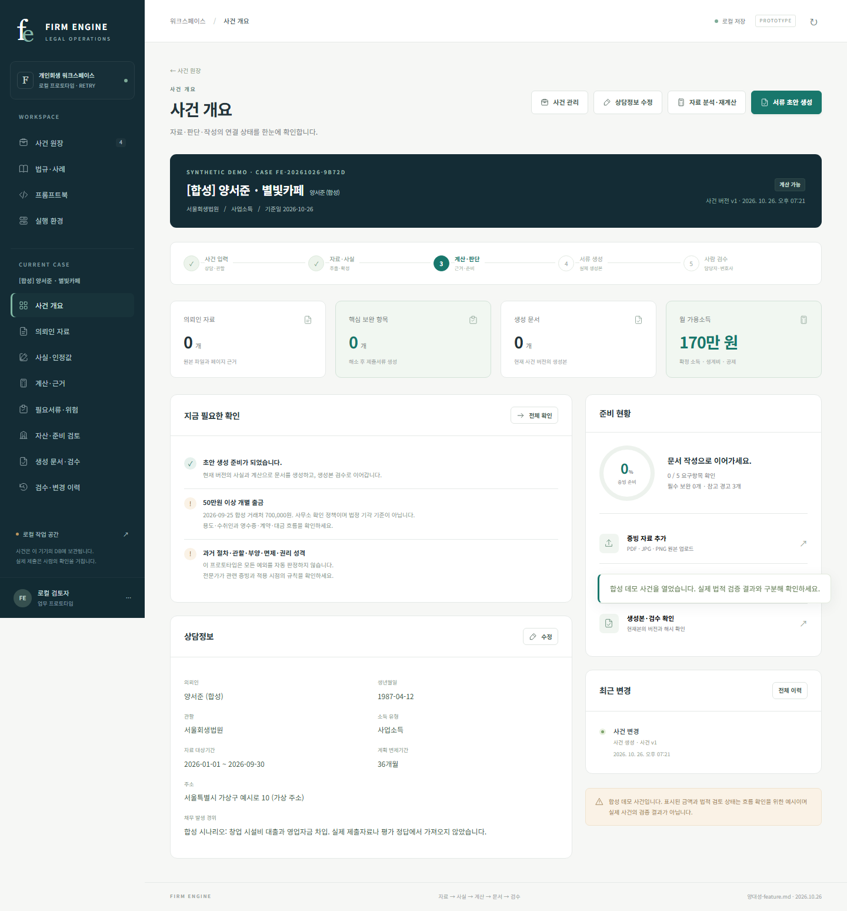

# Firm Engine · Proto Retry

현재 [`양대성-feature.md`](../../../docs/specs/양대성-feature.md)의 **10절 수정 요구사항을 우선**하여 새로 만든 로컬 프로토타입입니다. 기존 `firmengine-proto`의 코드·프롬프트·평가 결과는 재사용하지 않았습니다. 적용 스킬은 `prototype`, `Sites`의 로컬 제작 흐름, OpenAI API 구현의 `OpenAI Docs`입니다. 실제 영속 DB와 n8n 연결은 이 명세의 요구사항에 따라 구성했습니다.

## 실행

Python 3.11 이상, Node.js 22.16 이상이 필요합니다. 이 디렉터리에서 실행합니다.

```powershell
python -m pip install -r requirements.txt
npm install
npm start
```

- 웹: <http://127.0.0.1:8091>
- 이 프로젝트의 n8n: <http://127.0.0.1:5681>
- 종료: 실행 터미널에서 `Ctrl+C`. 사건은 삭제되지 않습니다.

이미 설치된 n8n 또는 npm 캐시를 찾으면 별도 설치 없이 `python scripts/run_local.py`로 시작할 수 있습니다. n8n 시작을 생략해 화면부터 확인하려면 `python scripts/run_local.py --without-n8n`을 실행합니다. 연결 가능한 n8n Webhook이 없으면 동일 계산 코드를 **local-node**로 실행하며 n8n 실행 성공으로 표시하지 않습니다. 사용 중인 다른 포트나 다른 프로젝트의 n8n 데이터를 강제로 종료·수정하지 않습니다.

API 키는 이 폴더 또는 상위 폴더의 `.env`에서 `OPENAI_API_KEY` 또는 `OPEN_AI_API_KEY`를 읽습니다. 기본 추론 모델은 `gpt-6-luna`이며 화면·워크플로에는 키를 넣지 않습니다. 키가 없으면 AI 추출 성공을 가장하지 않고 원본 확인 대상으로 남깁니다. 임베딩 검색은 별도의 `text-embedding-3-small`을 사용합니다.

## 확인할 흐름

1. 첫 화면에서 **합성 데모 열기**로 실제 사건과 분리된 예시를 엽니다.
2. 소득·채권·재산과 계산 근거를 확인하고 **서류 초안 생성**을 실행합니다.
3. 기본 신청서류 6종, 변제예정액표, 증빙·검토표, XLSX 및 ZIP의 실제 파일을 내려받습니다.
4. 생성본을 미리보고 담당자 확인 후 변호사 최종 확인을 기록합니다. 확인은 파일 해시·생성본·사건 버전에 연결됩니다.
5. 인정경비 등 원본 입력을 정정하면 계산이 바뀌고 기존 파일·확인은 과거본으로 구분됩니다. 새 파일을 생성·검수해야 합니다.

새 실제 사건에서는 증빙을 업로드하고 **자료 역할과 페이지 매핑**부터 지정합니다. 업로드 기본 역할은 `unknown`입니다. 혼합 PDF의 법원 제출본은 `evaluation`, 의뢰인 증빙은 `evidence`로 분리해야 합니다. 평가·행정·미분류 페이지는 생성기에 전달하지 않습니다. 금액의 사실 확인과 경비·공제·채권 성격의 법적 인정은 별도로 확인합니다.

## 저장과 삭제

`.local/ledger.sqlite3`에 사건·변경 이력·영속 작업·검수·비공개 AI 호출기록을 저장하고, `.local/objects/`에 UUID 객체 키로 원본과 생성본을 보관합니다. 서버 재시작 후 다시 열 수 있습니다. 일반 로그나 공개 예시에 실제 사건 원문·키를 넣지 않습니다. 브라우저 영구 저장소에는 사건 내용을 저장하지 않습니다.

- **자료 제외**: 현행 사건 입력에서 제외하고 이력 재현을 위해 원본을 보존합니다.
- **사건 보관**: 사건과 파일을 보존합니다.
- **사건 삭제**: 사건 DB 기록·호출·원본·생성물·검수 이력을 삭제합니다. 사용자가 이미 내려받은 외부 사본은 별도로 남습니다.
- 로컬 운영자 권한으로 동작하는 업무 검증용입니다. 검수자 이름 입력은 운영용 인증·역할 권한을 대신하지 않습니다.

## 검증과 평가

```powershell
python scripts/smoke.py
# 웹 서버가 실행 중이고 Playwright가 준비된 환경에서 선택 실행
python scripts/browser_smoke.py
```

합성 통합 확인은 실제 파일·해시, 결정론적 계산, 동시 수정 충돌, 필수 미해결 생성 보류, 평가 페이지 제외, 변경 후 재검수와 재시작 복구를 확인합니다. 화면 검증은 데스크톱·모바일 레이아웃과 문서 생성·검수 동작을 확인합니다. 합성 확인 수를 실제 사건의 서류 품질 합격률로 해석하지 않습니다.

실제 샘플 PDF와 그 자료의 페이지 구성·사례별 평가 결과는 공개 저장소에서 제거했습니다. 별도 입력을 사용할 때에는 승인된 원본과 검토된 페이지 구분을 비공개 작업 폴더에 준비해야 합니다.

원문·평가 정답·실행 산출물은 Git에서 제외된 `.local/`에 보관합니다. 공개 코드는 합성 테스트와 일반적인 평가 절차만 제공합니다.

## 구현 범위와 검증 한계

[구현 현황](docs/IMPLEMENTATION.md), [실제 구조](docs/ARCHITECTURE.md), [공개 양식과 매핑](templates/README.md), [독립평가 도구](evaluation/README.md)를 참고하세요.

공개 HWP 원본을 새로 수집해 DOCX 매핑을 만들었으나, 사용자가 실제 받은 양식과의 전문가 최종 대응 검수는 별도입니다. 담보·다툼·재단/비면책 채권의 배분, 현재가치·면제재산의 법적 판단, 시세 공급자 인증, 운영용 사용자 권한과 외부 저장소 동기화는 미완료 범위로 표시합니다. 법령 원문 조회와 변경 해시는 제공하지만 변경 의미를 자동 승인하지 않습니다. 일일 09:00 법령 조회 워크플로 정의는 실제 스케줄 활성·발화 검증과 구분합니다.



