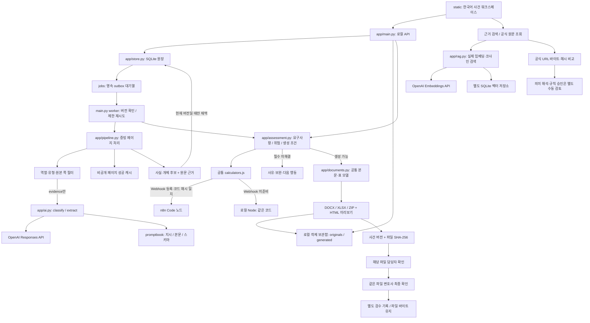
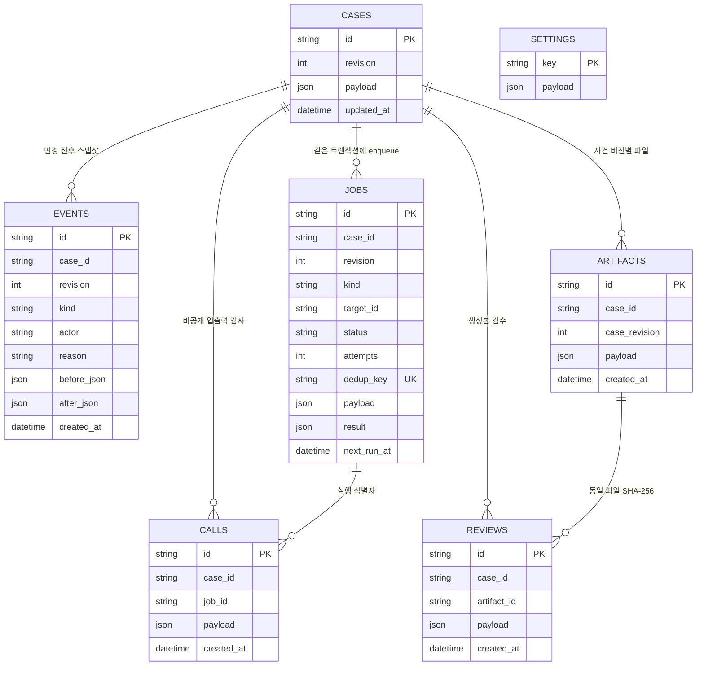
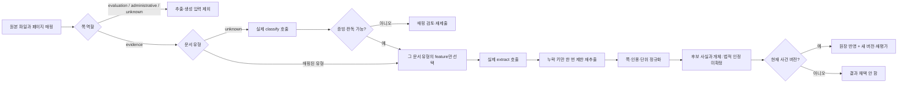
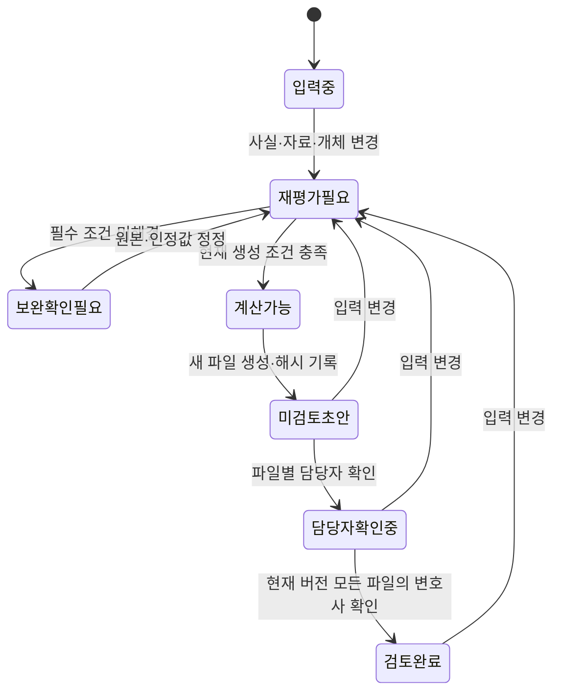
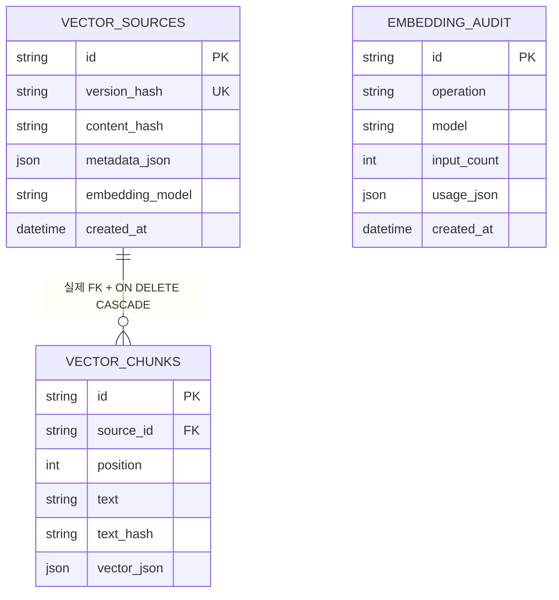

# 현재 구현 구조

이 문서는 새 `firmengine-proto-retry`의 실제 모듈과 연결을 설명한다. 기준은 [`양대성-feature.md`](../../../../docs/specs/양대성-feature.md)의 10절과 현재 소스다. 목표 아키텍처의 모든 기능이 이미 연결되었다고 표현하지 않으며, 실제 샘플의 내용이나 평가 정답·결과를 근거로 사용하지 않는다.

## 실행 경계

프론트엔드와 FastAPI는 기본 `127.0.0.1:8091`, 격리된 n8n은 기본 `127.0.0.1:5681`에서 실행한다. `scripts/run_local.py`가 자신이 만든 프로세스를 관리한다. `--without-n8n`은 명시적인 로컬 Node 계산 모드다. UI는 정적 HTML/CSS/JavaScript이므로 별도 프론트엔드 빌드는 없다.

현재 n8n 연결은 결정론적 계산 Webhook이다. 분류·추출은 API 작업자가 OpenAI를 직접 호출한다. n8n에서 모든 에이전트를 조율하는 전체 워크플로를 이미 구현한 구조는 아니다. 검색 API도 독립된 기능이며 현재 분류·추출 호출에 검색 결과를 자동 주입하지 않는다.

## 모듈 책임

| 모듈 | 책임 | 외부 효과 |
| --- | --- | --- |
| `static/` | 사건 선택·CRUD, 자료 역할/페이지 매핑, 사실 정정, 계산·위험·생성본·검수, 근거 검색, 프롬프트 편집 | 같은 출처의 `/api/*` 호출 |
| `app/main.py` | HTTP 입력 확인, 로컬 경계, 작업자 생명주기, 문서 보관, 버전 검사, 결과 채택, 생성·검수 API | SQLite·객체 저장·공식 원문 HTTP 수집 |
| `app/store.py` | 사건 JSON·전후 스냅샷·이벤트·작업·생성물·검수·호출기록 | SQLite 트랜잭션, 연결된 파일 삭제 |
| `app/pipeline.py` | 증빙 페이지 선택, 문자/이미지 입력, 유형별 feature, 누락 범위 재추출, 출처 검사, 개체 후보, 계산 경로 선택 | OpenAI 호출, 페이지 캐시, n8n 또는 Node |
| `app/ai.py` | 상위/프로젝트 `.env`와 환경변수 설정, 역할별 프롬프트 재로드, JSON Schema 응답, 호출 제한·재시도·감사정보 | OpenAI Responses API; 호출기록 저장은 호출자가 담당 |
| `app/assessment.py` | 준비 요구사항, 필수 차단·참고 위험, 계산 결과 연결 | 공통 계산 경로 호출 |
| `app/documents.py` | 본문·반복표의 공통 모델, 미리보기, DOCX/XLSX, ZIP·생성 매니페스트 | 새 생성 디렉터리에만 파일 작성 |
| `app/rag.py` | 지식 판본·청크·임베딩 보관, 검색 전 적용 범위·누출 필터, 실제 코사인 유사도 | OpenAI Embeddings API와 별도 SQLite |
| `workflows/calculators.js` | 금액·기간·채권 분류에 따른 정수 산술과 제한된 배분 | 입력을 받아 JSON 반환 |
| `workflows/build_workflows.py` | 공통 코드를 n8n Webhook → Code → 응답 노드로 구성, 코드 해시 연결 | 계산 워크플로 JSON 생성 |
| `scripts/run_n8n.py` | 실행 바이너리 탐색, 이 프로젝트 전용 n8n DB·포트, 워크플로 준비·게시 | 격리된 n8n 실행; 다른 인스턴스 데이터 수정 금지 |
| `templates/` | 새로 받은 공개 원본·출처·SHA-256, 편집형 대응 서식 | 원본 재수집·재구성은 별도 명령 |
| `knowledge/catalog.json` | 공식 근거·시점·상태와 제한된 초기 위험 카탈로그 | 일반 근거 자산이며 사건 DB와 구분 |

## SQLite 원장과 outbox

`cases.payload`가 현재 사건의 상담정보·문서 메타데이터·사실·소득·채권·재산·거래 배열을 가진다. 다음 ER 다이어그램의 사건 연결은 논리 관계다. 원장 스키마는 모든 관계에 DB 외래키를 선언하지 않으며, 문서·사실·개체를 독립 테이블로 정규화하지 않았다.

`create_case()`와 `mutate()`는 사건 변경·전후 이력·작업 enqueue를 같은 SQLite 트랜잭션에 넣는다. 별도 `outbox` 테이블 대신 `jobs`가 영속 outbox를 겸한다. `case_id:revision:kind:target_id` 중복 키로 같은 작업 등록을 억제한다. `BEGIN IMMEDIATE`와 `expected_revision` 검사로 오래된 사용자의 수정·추출 결과 채택·파일 생성을 거부한다.

변경 시 이전 버전의 대기·실행·재시도 작업은 `superseded` 처리하고 새 재평가 작업을 등록한다. 실행 중 이미 시작한 HTTP 요청 자체를 모두 취소하는 구조는 아니지만, 결과 채택 시 사건 버전을 다시 검사한다. 서버 시작 시 남은 `running`은 `queued`로 돌려 다시 실행 가능하게 한다. 작업자는 현재 한 개이며 독립 문서·페이지 호출 내부에서 동시성을 제한한다.

`events`는 원장의 전후 상태를 보관한다. 화면 API에서는 큰 `before_json`·`after_json`을 기본 응답에서 제외한다. 계산 결과는 현재 사건의 `_assessment`에 캐시하며, 별도의 불변 계산 실행 원장이나 제출 스냅샷 테이블 전체를 구현하지 않았다.

## 추출 경계와 호출 기록

프롬프트 역할은 `classify`, `extract`, `validate`, `judge`, `draft`, `law_update`, `evaluate`로 나누어 정의했다. 현재 `ai.read_prompt().connected`와 실제 파이프라인 호출은 앞의 2개 역할뿐이다. 원문 검증·준비 판단·문서 본문 구성·독립평가가 모두 나머지 프롬프트의 에이전트 호출로 수행되는 것은 아니다.

실제 호출에는 작업 범위·시스템 지시·본문·프롬프트 해시·모델·출력·사용량·시도·실패 유형이 비공개 `calls`에 남는다. 키·원문이 포함될 수 있는 공급자 HTTP 예외 전문을 일반 오류로 내보내지 않는다. 응답의 메시지 `output_text`만 읽으며 추론 블록을 저장하지 않는다. `store=False` 설정과 외부 서비스 보관·학습 정책 검증 완료는 같은 의미가 아니다.

성공 페이지 캐시는 파일 해시·원본 쪽·역할·유형·기간·모델·프롬프트·feature 정의를 키로 삼아 같은 사건 내부의 성공 결과를 재사용한다. 사건 삭제 경로는 기본 루트와 설정된 데이터 루트 양쪽의 사건별 캐시·신뢰한 연결 캐시를 정리한다. 캐시 작성 경로 자체는 현재 프로젝트 `.local/`이며 완전한 저장 제공자 추상화는 아니다. 실행 중 삭제와 지연 완료 후 재기록의 동시성 검증도 남아 있다. [저장·삭제·기록](IMPLEMENTATION.md#저장삭제기록)에서 현재 경계를 확인할 수 있다.

## 계산·생성·검수 의존성

계산에는 필요한 소득·채권·재산·기간·공제·승인 입력만 전달한다. 사건 전체 진술이나 PDF 본문을 n8n에 보내지 않는다. n8n 생존 응답만으로 사용할 수 있다고 판단하지 않고 준비 상태와 계산 Webhook 등록까지 확인한다. n8n 응답의 계산 코드 해시가 현재 `calculators.js`와 다르면 채택하지 않는다.

금액은 정수 원 단위로 계산하며, 월평균 절사·채권별 잔여 원 배분·마지막 회차 조정을 명시한다. 담보·다툼·재단·비면책 등 현재 지원하지 않는 배분 조건은 단순 일반채권 비례배분에 섞지 않고 보류한다. 명목 총변제액과 현재가치, 시가와 법적 청산가치를 동일한 값으로 표현하지 않는다. 현재가치 산정과 고급 법적 예외는 수동 검토 범위다.

생성 API는 최신 사건 버전·준비 조건을 다시 확인한 뒤 새 객체 디렉터리에 작성한다. `documents.py`의 공통 본문·표 모델이 미리보기와 실제 편집형 파일의 기준이다. 생성 매니페스트에 원본 서식 출처·해시·사건 버전·산식·서식 판본과 파일 해시를 남긴다. 검수 시 파일 SHA-256을 다시 계산하고 같은 사건 버전인지 확인한다.

과거 파일·확인은 삭제하지 않고 과거본으로 남긴다. 검수 후 파일 내용은 조용히 바꾸지 않는다. 최신 검수 기록표는 별도 DOCX로 작성·응답하고 임시 파일을 정리한다. 원본 파일과 별도 검수 메타데이터를 합쳐서 보관해야 최신 확인 상태를 해석할 수 있다.

현재 생성 조건은 서식 전체 필수항목의 포괄적 검증기가 아니다. `확인 필요`가 남은 본문 항목을 자동으로 최종 완료에서 제외하는 기능, 변경된 법령·산식·템플릿 파일을 자동 감지해 모든 사건을 무효화하는 기능은 후속 보완 대상이다.

## 지식 벡터와 판본

`app/rag.py`는 `text-embedding-3-small`의 실제 임베딩을 받아 `knowledge-vectors.sqlite`에 저장한다. 1,000자 청크와 출처·원문 해시·메타데이터·모델을 포함한 판본 해시를 기록한다. 쿼리도 실제 임베딩으로 만들고 저장 벡터와 정확 코사인 유사도를 비교한다. Qdrant나 근사 최근접 인덱스, 문자열 검색 대체 경로는 없다.

컬렉션은 `law`, `practice`, `public_observation`, `success_case`다. 검색 전에 관할·적용 시작/종료일·컬렉션·검토 상태·평가 전용 여부·자료 묶음 제외 목록을 적용한다. 법령·준칙·성공사례는 검토된 자료만 검색하고, 평가 전용 자료와 현재 사건의 자료 묶음은 제외한다. 사례·관찰·평가 자료는 `dataset_group_id`가 필수다. 이는 선언된 자료 묶음 식별자를 이용한 경계이며, 잘못 붙인 식별자를 내용만으로 자동 알아내는 시스템은 아니다.

벡터 적재·검색 API는 존재하지만 사건 자료를 자동으로 지식 저장소로 보내지 않는다. 검토된 실제 성공사례를 기본 데이터로 넣지 않으며, 독립평가 정답을 검색 예시로 쓰지 않는다. 키 부재·공급자 실패·적용 가능한 벡터 부재를 별도 응답으로 반환한다. 빈 필터 결과에서는 실제 쿼리 임베딩을 호출하지 않고 `vector_store_filtered_empty`로 표시한다.

## 공식 원문 갱신과 승인

`POST /api/knowledge/refresh`는 허용된 국가법령정보센터·서울회생법원 URL에서 원문 바이트를 수집하고 로컬 판본 파일·SHA-256·이전 해시·수집시각을 기록한다. 변경을 감지한 사실은 법적 의미 변경이나 산식의 검토 완료를 의미하지 않는다.

`POST /api/approvals`는 검토자·사유와 규칙/서식 판본 확인을 로컬 설정으로 기록해 새 사건에서 재사용한다. 새 법령을 읽고 코드를 자동 작성·실행·승인하거나 적용일에 모든 사건을 자동 전환하는 기능은 없다. `law-watch.json`은 09:00 Asia/Seoul 스케줄 정의지만 비활성 상태이며 실제 발화 확인과 구분한다.

## 저장 제공자와 운영 경계

원본·생성물 참조는 `storage_provider=local`, `namespace`, `object_key`, 해시로 표현한다. 원장과 객체는 기본 `.local/` 아래에 있으며 `FIRMENGINE_DATA_DIR`로 일부 저장 경로를 지정할 수 있다. 추출 캐시와 n8n 상태는 현재 프로젝트 `.local/`에 별도로 남으므로 완전한 저장 제공자 추상화는 아니다.

API는 루프백 실행·Host와 변경 요청 Origin 검사·`Cache-Control: no-store`·접근로그 비활성화로 로컬 사용 경계를 둔다. 이 경계는 로그인·권한 분리·데이터 암호화·운영 감사 정책의 대체가 아니다. 실제 법원 제출, 외부 메시지 발송, Google Workspace/클라우드 동기화, 외부 시세 공급자 인증은 연결되어 있지 않다.

현재 구조가 충족한 연결과 남은 명세 차이는 [IMPLEMENTATION.md](IMPLEMENTATION.md)에 별도로 정리했다. 실제 샘플 품질평가와 시간 목표는 이 구조 문서로 합격을 주장하지 않는다.
