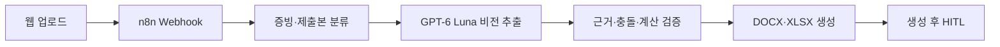

# Firm Engine · 로컬 n8n P0

의뢰인 증빙을 업로드하면 GPT-6 Luna가 원문 근거와 값을 추출하고, n8n이 검증·계산·법원 양식 초안 생성을 연결합니다. 생성 후 담당자와 변호사가 확인하는 로컬 프로토타입입니다.

**인계 상태:** n8n 2.45.3 설치, 워크플로 등록·활성화와 로컬 프론트/API·n8n 기동을 완료했습니다. 전체 92쪽 샘플 실행·독립 비교 평가는 사용자 테스트로 남겨뒀습니다. 초기 코드·화면 검사와 별도의 평가 정답 준비는 중단 요청 전에 수행했습니다.

화면은 [기존 변호사·직원용 DX 프론트엔드](https://github.com/equipment0226/frontend_lawyerandstaff)의 녹색·아이보리 디자인과 작업 탭을 참고했습니다. [기존 백엔드](https://github.com/equipment0226/backend)의 공개 법원 서식 자산을 선택 재사용했으며, 이 프로토타입의 실행에는 기존 서버가 필요하지 않습니다.

## 실행

환경: Python 3.11 이상, Node.js 20.19~24.x. 이 작업에서는 Node 24와 npm 설치형 n8n 2.45.3을 사용합니다. Docker가 필요하지 않습니다.

이 디렉터리에서 PowerShell로 실행합니다.

```powershell
python -m venv .venv
.venv\Scripts\python.exe -m pip install -r requirements.txt
npm.cmd ci --no-audit --no-fund
.venv\Scripts\python.exe scripts/run_local.py
```

이미 의존성이 설치되어 있으면 `start-local.cmd`를 실행합니다. 실행기는 최초에 워크플로를 가져오고 활성화한 뒤 API와 n8n을 함께 시작합니다. 이후에는 동일한 등록·게시 버전을 재사용하며 편집기에서 변경한 워크플로를 자동으로 덮어쓰지 않습니다.

- 앱: <http://127.0.0.1:8010>
- n8n 편집기: <http://127.0.0.1:5679>
- API 문서: <http://127.0.0.1:8010/docs>
- 종료: 실행 터미널에서 `Ctrl+C`.

n8n 편집기 첫 접속 시 로컬 소유자 계정을 설정합니다. 앱의 워크플로 실행은 가져온 Webhook을 사용합니다. 다른 프로그램이 포트를 사용한다면 이 폴더의 `.env`에 `API_PORT`, `N8N_PORT`를 지정하고 실행기를 다시 시작합니다. 내부 작업 브로커는 편집기와 다른 포트인 `5680`을 사용하며, `N8N_RUNNERS_BROKER_PORT`로 지정할 수 있습니다. n8n 설정·DB는 `.runtime/n8n`에 격리되어 기존 n8n 설정을 변경하지 않습니다.

## API 설정

상위 폴더 `../.env`를 자동으로 읽습니다. `OPENAI_API_KEY`와 기존 파일의 `OPEN_AI_API_KEY`를 모두 지원합니다. 이 폴더의 `.env` 또는 환경변수로 덮어쓸 수 있습니다. 키를 프론트엔드·워크플로 JSON에 넣지 않습니다.

```dotenv
OPENAI_API_KEY=your-key
OPENAI_MODEL=gpt-6-luna
OCR_CONCURRENCY=3
OCR_BATCH_PAGES=4
```

`gpt-6-luna`를 Responses API로 호출하며 `store:false`를 사용합니다. 원본 PDF를 Files API에 올리지 않고 증빙 페이지를 메모리에서 이미지로 변환해 전달합니다. `store:false`가 OpenAI의 모든 외부 보관정책을 대체하는 것은 아닙니다. 실제 운영 전 계정·서비스의 데이터 정책을 별도로 확인해야 합니다.

## 사용 흐름

1. PDF·JPG·PNG를 업로드합니다. 혼합 PDF라면 증빙 페이지 범위를 직접 지정할 수 있습니다. 지정하지 않으면 AI가 증빙·완료된 제출서류·행정서류를 분류합니다. 자동 분류는 담당자가 결과를 확인해야 합니다.
2. ‘분석 시작’을 누르면 n8n 워크플로가 실행됩니다. n8n 연결 실패를 API 직접 실행으로 숨기지 않습니다.
3. 추출된 값에서 문서·페이지·발췌 근거를 확인합니다. 금액·사실·적용기간을 수정·확정하거나, 이전 기간 자료 등 적용하지 않을 항목을 사유와 함께 제외합니다.
4. 인정 월 영업소득·인정 생계비·변제기간·월 보수·청산가치 등은 담당자가 근거와 적용 기준을 확인하여 입력합니다. 누락을 0으로 채우거나 36개월을 기본 적용하지 않습니다.
5. DOCX 6종과 계산·증빙 XLSX를 내려받을 수 있습니다. 입력값을 바꾸면 기존 파일과 확인이 무효화되므로 ‘문서 재생성’을 실행합니다.
6. 실제 생성본과 원본 양식의 대응을 확인한 다음 담당자 확인, 변호사 최종 확인을 진행합니다. 미해결 항목이 남으면 검토 완료 처리를 차단합니다.

계산값이 부족해도 작업용 문서는 생성되며 ‘미검토 초안’, ‘확인 필요’가 표시됩니다. 최종 확인은 법원 접수·인가를 뜻하지 않습니다. 현재 확인자 입력은 로컬 데모용 기록이며 운영용 계정·역할 인증은 아직 연결하지 않았습니다.

## n8n 워크플로

`workflows/firmengine-p0.json`을 n8n 편집기로 열어 각 단계를 볼 수 있습니다. `scripts/run_local.py --write-workflow`로 설정 포트를 반영한 JSON을 다시 만듭니다.



실제 AI·문서 처리 코드는 로컬 API에 있고 n8n의 HTTP Request 노드가 단계별로 호출합니다. n8n에는 `session_id`와 해당 실행에만 사용하는 `run_token` 및 단계 상태만 전달합니다. 원본·추출값·API 키를 노드 출력에 기록하지 않습니다. 실행 데이터 저장은 성공·실패·수동 실행 모두 비활성화합니다.

## 양식과 현재 구현 범위

- 생성: 개시신청서, 채권자목록, 재산목록, 수입 및 지출 목록, 진술서, 변제계획안의 편집형 DOCX와 계산근거 XLSX.
- `templates/originals`: 출처 해시를 검증한 공개 빈 PDF/HWP 원본 12개.
- `templates/*.docx`와 `templates/catalog.json`: 공식 구역·항목에 대응한 편집형 템플릿과 출처·버전.
- 템플릿은 **공식 항목을 재구성한 초안**이며 원본 HWP와 동일한 페이지 배치나 제출 가능성을 보증하지 않습니다. 사용자가 실제 받은 최신 요청양식과의 검수·매핑이 필요합니다.
- 미구조화 특약·특수 부속표·채권자별 변제 배분 등 미구현 영역은 확인 필요로 남깁니다. 법률 산식·지원 범위의 전문가 검토는 별도입니다.
- 규칙 연결은 입력 → 원문 근거 → 확인값 → 결정론적 산술 → 문서 항목으로 추적합니다. 자동 법령 수집·규칙 편집기·인가 확률 예측은 포함하지 않습니다.
- P1 필요서류 정의는 아직 완성된 조건부 Law-Graph 서비스가 아닙니다. 이 P0는 제공된 증빙에서 양식 초안을 만드는 흐름에 집중합니다.

## 샘플과 독립 평가

화면의 ‘샘플로 시작’은 `../sample.pdf`와 해시가 일치하는 `evaluation/sample_manifest.json`을 사용합니다.

- 원본: 118쪽 스캔 PDF.
- 생성 입력: 증빙 92쪽.
- 비교 전용: 이미 작성된 제출본 24쪽. 생성기에는 이미지·OCR·정답값을 전달하지 않습니다.
- 제외: 위임·행정서류 2쪽.

서버 실행 후:

```powershell
.venv\Scripts\python.exe scripts/run_sample.py
.venv\Scripts\python.exe evaluation/evaluate_sample.py
```

`run_sample.py`는 실제 n8n Webhook을 호출하고 완료된 파일을 내려받도록 구성했습니다. 평가기는 별도 추출한 제출본 목표값과 생성 결과·실제 DOCX/XLSX 내용을 비교합니다. 자세한 재현은 [evaluation/README.md](evaluation/README.md)를 참고합니다. 전체 평가가 실행된 후에만 `evaluation/REPORT.md`와 `report.json`이 생성됩니다.

정답·개인별 생성 결과는 Git 제외된 `.runtime/evaluation`에만 저장합니다. 이 명시적 평가용 사본은 앱 세션 만료와 별도로 보관되므로 평가를 마친 뒤 직접 정리할 수 있습니다. 공개 평가 보고서에는 원문·이름·개별 금액을 넣지 않습니다. 한 사건의 제출본 대조는 범용 정확도나 시간 20% 단축 달성의 근거가 아니며, 시간 비교에는 동일 조건의 수작업 측정이 추가로 필요합니다.

## 검증

```powershell
.venv\Scripts\python.exe -m unittest discover -s tests -v
.venv\Scripts\python.exe -m compileall -q app scripts evaluation
node --check static/app.js
```

추가로 Playwright가 설치되어 있으면 서버 실행 후 `python scripts/browser_smoke.py`로 화면을 확인합니다. 합성 자료로 검증하며 실제 AI 호출은 하지 않습니다.

## 로컬 자료 관리

앱 세션은 명시적 종료 또는 사용자 활동 없는 60분 뒤 삭제합니다. 폴링은 만료 시간을 연장하지 않습니다. 프로세스 재시작 시 복구하지 않고 남은 세션 임시파일을 정리합니다. 사용자가 내려받은 파일과 명시적 평가용 사본은 별도입니다.

`.env`, `.runtime`, `node_modules`, `.venv`, 개인별 평가 결과는 Git에서 제외합니다. 원본 `sample.pdf`는 상위 폴더에서 읽으며 이 프로젝트의 공개 서식 자산에 포함하지 않습니다. 실제 고객자료·키를 저장소에 추가하지 않도록 합니다.

## 주요 파일

| 경로 | 역할 |
|---|---|
| `app/main.py` | 업로드·세션·n8n 단계 API·HITL·다운로드 |
| `app/ai.py` | GPT-6 Luna 페이지 분류·비전 추출 |
| `app/engine.py` | 원문 근거 연결·충돌·누락 검증·산술 |
| `app/rendering.py` | 공개 양식 기반 DOCX·XLSX 생성 |
| `static/` | DX 스타일의 로컬 작업 화면 |
| `workflows/firmengine-p0.json` | 가져오기 가능한 n8n 워크플로 |
| `scripts/run_local.py` | 격리 n8n 초기화·활성화·API 동시 실행 |
| `evaluation/` | 독립 페이지 분리·제출본 대조 평가 |

참고 문서: [양대성 기능 명세](../../../docs/specs/양대성-feature.md), [n8n npm 설치](https://docs.n8n.io/hosting/installation/npm/), [GPT-6 Luna API](https://developers.openai.com/api/docs/models/gpt-6-luna).
