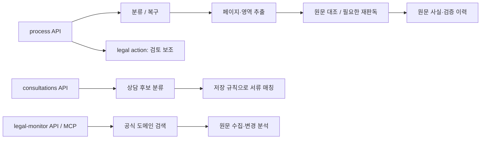

# 현재 AX 프롬프트 지도

v43은 문구를 [reference-prompt-policies.json](../lib/reference-prompt-policies.json)에 모으고 [reference-prompts.ts](../lib/reference-prompts.ts)의 `renderPromptPolicy()`로 조합합니다. 모델은 [domain.ts](../lib/domain.ts)의 `gpt-6-luna`, OCR 프롬프트 버전은 [category-contract.ts](../lib/category-contract.ts)의 `luna-evidence-3.21.0`, 상담 버전은 [intake-types.ts](../lib/intake-types.ts)의 `intake-classifier-5.3`입니다. n8n을 경유하지 않습니다.

| 단계 / agent | 정리한 프롬프트 | 실제 조합·호출 원본 |
| --- | --- | --- |
| 최초 분류 `document_classifier` | [01-classifier.md](ax-site-prompts/01-classifier.md) | [classification-recovery.ts](../lib/classification-recovery.ts)의 분류 지시문·스키마와 [pipeline.ts](../lib/pipeline.ts) |
| 불명확 분류 재확인 `document_classifier_recovery` | [01-classifier.md](ax-site-prompts/01-classifier.md) | 같은 파일의 복구 지시문·스키마 |
| 페이지·영역 원문 추출 `evidence_extractor` | [02-extractor.md](ax-site-prompts/02-extractor.md) | [extraction.ts](../lib/extraction.ts)의 `EXTRACT_INSTRUCTIONS`, `DOC_FIELDS`, `sourceInstructions`, `PAGE_SCHEMA`와 pipeline의 입력 조합 |
| 원문 대조 `source_verifier` / 표적 재판독 `targeted_rereader` | [03-verifier-and-repair.md](ax-site-prompts/03-verifier-and-repair.md) | [pipeline.ts](../lib/pipeline.ts)의 stage별 `verifierInstructions`, `verifierPromptText` 및 [extraction.ts](../lib/extraction.ts)의 `VERIFY_SCHEMA` |
| 법적 체크 검토 보조 `legal_checklist_reviewer` | [04-legal-reviewer.md](ax-site-prompts/04-legal-reviewer.md) | pipeline의 `reviewLegal()`, [reference-prompts.ts](../lib/reference-prompts.ts)의 `legalReviewInstructions()`, [legal-review-packet.ts](../lib/legal-review-packet.ts) |
| 상담 후보 분류 `consultation_classifier` | [05-consultation-classifier.md](ax-site-prompts/05-consultation-classifier.md) | [intake-source-spans.ts](../lib/intake-source-spans.ts)의 원문 구간 → [intake-classifier.ts](../lib/intake-classifier.ts)의 요청 → [intake-classifier-response.ts](../lib/intake-classifier-response.ts)의 대상·구간 검증 → [intake-store.ts](../lib/intake-store.ts)의 저장 |
| 법령·법원 문서 검색 `legal_monitor_*_discovery` / 변경 분석 `legal_monitor_change_analysis` | [06-legal-monitor.md](ax-site-prompts/06-legal-monitor.md) | [reference-monitor-policies.json](../lib/reference-monitor-policies.json), [legal-monitor-provider.ts](../lib/legal-monitor-provider.ts) |
| 계산·문서작성 | [08-calculator-and-document-writer.md](ax-site-prompts/08-calculator-and-document-writer.md) | [case-agent.ts](../lib/case-agent.ts), [calculator-tools.ts](../lib/calculator-tools.ts), [document-writer.ts](../lib/document-writer.ts)에는 별도 AI 프롬프트가 없음 |

[07-policy-catalog.md](ax-site-prompts/07-policy-catalog.md)에 현재 seed 정책 전체와 자리표시자를 실었습니다. 구체적인 문구를 수정할 때는 정책 ID를 확인하고 원본 JSON과 해당 조합 코드·출력 스키마를 함께 검토합니다. 이 사본을 고쳐도 실행에는 반영되지 않습니다.

## 실행과 기준정보 판본

영역 복구·누락 재추출·저장 판독 재검증의 상태와 한도는 [pipeline.ts 사본](ax-site-prompts/source/pipeline.ts.txt)을 확인하세요. 상담은 원문을 구간으로 나눠 대상별 claim과 참조 ID를 받고, 서버가 전체 구간의 검토 목록과 정확한 원문 연결을 검사합니다. 이 결과는 `client_report` 후보이며 사건의 인정 사실로 자동 전환하지 않습니다. 감시는 변경 관찰·알림용이며 예약 연결 상태를 저장하는 작업 자체가 스케줄을 만들거나 새 법적 기준을 승인하지 않습니다.

[reference-runtime.ts](../lib/reference-runtime.ts)는 요청의 기준정보 값을 읽고, [reference-context.ts](../lib/reference-context.ts)는 판본·무결성을 검사합니다. `renderPromptPolicy()`는 이름 치환만 수행하며 삽입한 문자열을 다시 해석하지 않습니다. `lockedSafetyInvariant` 정책은 seed와 다른 값을 거부합니다. 법적 검토 지시문에는 현재 기준정보 판본 식별자가 추가됩니다.

이 묶음은 **현재 작업 파일의 seed 정책과 조합 코드**입니다. 라이브 D1 변경값, 실행 중인 모델 응답, 실제 사건 입력을 포함하지 않습니다. 정책 JSON 안의 `sourceBindings`는 이관 당시의 출처이며 현재 사본의 경로·해시는 `manifest.json`을 기준으로 봅니다.

## 공통 계약

| 정의 | 실제 원본 |
| --- | --- |
| 빈칸·가림·미관찰 구분과 bbox | [field-observation.ts](../lib/field-observation.ts) |
| record category·개별 field meaning 구분 | [category-contract.ts](../lib/category-contract.ts) |
| 문서의 원문 성격 진단 | [source-nature-context.ts](../lib/source-nature-context.ts) |
| 누락 위치 후보의 제한 | [coverage-review.ts](../lib/coverage-review.ts) |
| 문서 family 필드·적용 조건 | [document-agent-field-contracts.json](../lib/document-agent-field-contracts.json), [field-applicability-contracts.json](../lib/field-applicability-contracts.json) |
| 계약 축약과 작업 역할 | [document-agent-registry.ts](../lib/document-agent-registry.ts) |
| 문서별 상황·필요서류·출력 목표 | [workflow-rules.ts](../lib/workflow-rules.ts), pipeline의 `documentGuide()` |
| 실제 요청·추론 노력·타임아웃 | [luna.ts](../lib/luna.ts) |

[shared-instructions.md](ax-site-prompts/shared-instructions.md)에 공통 정적 지시문을 펼쳤습니다. 문서별 계약, 이미지, 페이지 번호, 이전 판독, 누락 후보, 법적 체크·상담 패킷은 요청마다 달라지므로 조합 코드를 함께 보관했습니다.

모델 요청은 `instructions`와 사용자 `input_text`를 구분하며 OCR에는 원본 또는 영역 이미지가 붙습니다. 출력은 각 strict JSON Schema가 제한합니다. 공통 설정은 `store: false`이며 추론 노력 기본값은 `low`, 상담 분류는 `medium`입니다. 토큰 상한은 호출 위치를 따릅니다. 감시의 발견 단계에는 공식 도메인으로 제한한 검색 도구가 추가됩니다. 원문 대조·재판독은 같은 모델의 별도 호출이고 기존 추출 후보를 함께 봅니다.

기존 [legacy-prompts/](legacy-prompts/)와 [n8n 노드 연결표](NODE_MAP.md)는 상위 Python 앱용 참고자료입니다.
