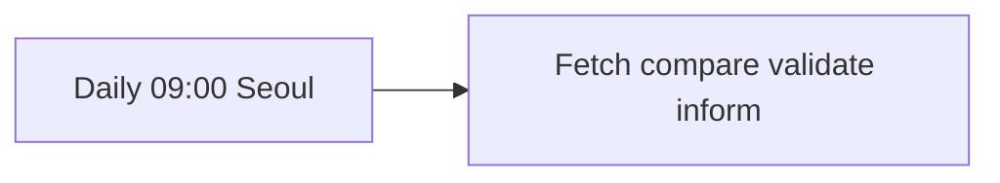

# n8n 노드와 프롬프트 연결표

현재 `ax-site`의 실행 경로는 Next.js API → TypeScript 파이프라인입니다. v43은 프롬프트 문구를 `reference-prompt-policies.json`에 두고 조합하며 상담 분류와 법령 감시도 직접 호출합니다. 아래 JSON 2개는 같은 상위 프로젝트의 **기존 Python 프로토타입 워크플로 참고본**입니다. 현재 AX API가 이 n8n 워크플로를 호출하거나 아래 `legacy-prompts/`를 읽는 연결은 저장소 코드에서 확인되지 않습니다.

두 원본 JSON의 `active` 값은 모두 `false`입니다. 기존 앱의 [실행기](../../scripts/run_local.py)는 워크플로를 가져와 게시할 수 있으므로, JSON의 값만으로 실행 중인 n8n의 게시·활성 상태를 판정할 수는 없습니다. 이 문서는 저장소 파일을 분석한 결과이며 실제 n8n 인스턴스를 조회한 결과가 아닙니다.

## 1. 사건 처리: `firmengine-p0.json`

[워크플로 JSON](workflows/firmengine-p0.json) · [원본 생성기](../../workflows/build.py) · [원본 stage 처리](../../app/runtime.py)

총 9개 노드 중 8개가 실행 체인을 이루고, 1개는 설명용 메모입니다. HTTP 노드의 기본 대상은 기존 Python API `http://127.0.0.1:8010`입니다.

```mermaid
flowchart LR
    intake["Case update"] --> classify["1. Document roles and types"]
    classify --> extract["2. Parallel scoped extraction"]
    extract --> prepare["3. Versioned calculation inputs"]
    prepare --> code["4. Exact legal arithmetic"]
    code --> validate["5. Requirements risks and generation gate"]
    validate --> generate["6. Generate or inform"]
    generate --> complete["7. Finish durable job"]
```

아래 AX 대응 항목은 역할을 비교하기 위한 안내입니다. n8n 노드를 그대로 이전했다거나 입출력 계약이 같다는 의미는 아닙니다.

| ID / 노드 이름 | n8n 유형과 실행 대상 | 기존 앱에서 사용하는 프롬프트 | 현재 AX의 관련 구현 |
| --- | --- | --- | --- |
| `intake` / `Case update` | `webhook` · POST `/webhook/firmengine-p0` · 수신 즉시 HTTP 202 | 없음. `session_id`, `run_id`, `run_token`을 받음 | [처리 API](../app/api/cases/[id]/process/route.ts)의 `POST`가 `next`, `next_batch` 등 action을 받아 [pipeline.ts](../lib/pipeline.ts)의 처리 함수를 직접 호출 |
| `classify` / `1. Document roles and types` | `httpRequest` · POST `/internal/stages/classify` | [classify/system.md](legacy-prompts/classify/system.md), [body.md](legacy-prompts/classify/body.md). [app/ai.py](../../app/ai.py)의 `classify()`에서 로드 | [pipeline.ts](../lib/pipeline.ts)의 `document_classifier`, `document_classifier_recovery` 호출과 [classification-recovery.ts](../lib/classification-recovery.ts)의 지시문·스키마 |
| `extract` / `2. Parallel scoped extraction` | `httpRequest` · POST `/internal/stages/extract` | [extract/system.md](legacy-prompts/extract/system.md), [body.md](legacy-prompts/extract/body.md). [app/ai.py](../../app/ai.py)의 `extract()`에서 로드 | [pipeline.ts](../lib/pipeline.ts)의 `evidence_extractor`와 독립 대조·재판독 처리. 지시문은 [extraction.ts](../lib/extraction.ts), 라우팅 계약은 [document-agent-registry.ts](../lib/document-agent-registry.ts) 등에서 조합 |
| `prepare` / `3. Versioned calculation inputs` | `httpRequest` · POST `/internal/stages/prepare` | 없음. 규칙 판본·매개변수와 계산에 필요한 제한된 snapshot을 구성 | [assessment.ts](../lib/assessment.ts)의 계산 입력 검증, [legal-rules.ts](../lib/legal-rules.ts)의 `CURRENT_RULESET`. AX에는 이 이름의 별도 n8n stage가 없음 |
| `code` / `4. Exact legal arithmetic` | `code` · `parameters.jsCode`의 결정론적 JavaScript 실행 | 없음. 원문 [calculators.js](../../workflows/calculators.js)를 [app/case_engine.py](../../app/case_engine.py)의 `n8n_code_source()`가 삽입 | [assessment.ts](../lib/assessment.ts)의 `calculateCase()`, `monthlyIncome()`, `liquidationContribution()` 등 TypeScript 계산 |
| `validate` / `5. Requirements risks and generation gate` | `httpRequest` · POST `/internal/stages/validate` · Code 결과를 `calculation_results`로 전달 | 결정론적 검증 후 **조건부** [judge/system.md](legacy-prompts/judge/system.md), [body.md](legacy-prompts/judge/body.md). API 키와 assertion이 있을 때 [app/guidance.py](../../app/guidance.py)의 `propose()` 실행 | [assessment.ts](../lib/assessment.ts)의 `assessCase()`, [workflow-rules.ts](../lib/workflow-rules.ts)의 `evaluateWorkflow()`. AI 보조 검토는 [pipeline.ts](../lib/pipeline.ts)의 별도 `reviewLegal()` / `legal_checklist_reviewer`이며 처리 API의 `action: "legal"`로 실행 |
| `generate` / `6. Generate or inform` | `httpRequest` · POST `/internal/stages/generate` | 없음. 기존 앱은 생성 gate를 확인하고 [app/rendering.py](../../app/rendering.py)의 `render_bundle()`로 생성하거나 필요한 조치를 안내 | [내보내기 API](../app/api/cases/[id]/export/route.ts)가 [document-writer.ts](../lib/document-writer.ts)의 `prepareDocumentWrite()`로 저장된 계산·현재 판본·gate를 확인한 뒤 [office-writer.ts](../lib/office-writer.ts)의 `writeOfficePackage()` 호출. 별도 AI 프롬프트 없음 |
| `complete` / `7. Finish durable job` | `httpRequest` · POST `/internal/stages/complete` | 없음. 기존 durable job 완료와 처리시간 기록 | [pipeline.ts](../lib/pipeline.ts)의 페이지 작업 저장·이벤트 기록, [server-store.ts](../lib/server-store.ts)의 저장 함수, [case-response.ts](../lib/case-response.ts)의 진행 상태 응답. AX에는 이 이름의 별도 n8n 노드가 없음 |
| `note` / `Case engine architecture` | `stickyNote` · 실행 체인과 연결되지 않은 설명 메모 | 없음. `parameters.content`는 아키텍처 설명이며 AI 입력이 아님 | 별도 실행 대응 없음 |

HTTP 노드는 프롬프트를 n8n 내부에서 실행하지 않습니다. 첫 분류 요청은 `$json.body`에서, 후속 요청은 `$json`에서 사건·실행 식별자와 임시 토큰을 전달합니다. `validate` 요청만 `calculation_results`를 추가합니다. `prepare`의 응답에 포함된 제한된 snapshot을 Code 노드가 계산합니다. 기존 API의 stage 라우트는 [app/api.py](../../app/api.py), 실제 단계 분기는 [app/runtime.py](../../app/runtime.py)에 있습니다.

`judge`의 출력은 추가 증빙·확인 요청 **제안**입니다. 기존 `guidance.propose()`는 최대 4개의 작은 작업으로 질문과 관련 사실, 최대 3개 검색 근거를 전달하고 반환된 finding·assertion·source ID를 검증합니다. 결정론적 생성 gate를 바꾸는 프롬프트가 아닙니다.

## 2. 법령 원문 점검: `law-watch.json`

[워크플로 JSON](workflows/law-watch.json) · [원본 생성기](../../workflows/build.py) · [원본 API](../../app/api.py) · [원문 비교 구현](../../app/knowledge.py)

| ID / 노드 이름 | n8n 유형과 실행 대상 | 기존 앱에서 사용하는 프롬프트 | 현재 AX의 관련 구현 |
| --- | --- | --- | --- |
| `schedule` / `Daily 09:00 Seoul` | `scheduleTrigger` · cron `0 9 * * *` · workflow timezone `Asia/Seoul` | 없음 | AX 코드에서 같은 일일 n8n 스케줄 연결은 확인되지 않음 |
| `check` / `Fetch compare validate inform` | `httpRequest` · POST `http://127.0.0.1:8010/internal/knowledge/check` · 본문 `token: $env.FIRMENGINE_INTERNAL_TOKEN` | 원문 수집·비교 과정에서 **조건부** [law-watch/system.md](legacy-prompts/law-watch/system.md), [body.md](legacy-prompts/law-watch/body.md). [app/knowledge.py](../../app/knowledge.py)의 `preview_change()`가 API 키가 있을 때 변경 검토용 미리보기를 생성 | v43의 [legal-monitor API](../app/api/legal-monitor/route.ts) / [MCP](../app/mcp/route.ts)와 [legal-monitor-provider.ts](../lib/legal-monitor-provider.ts)가 공식 검색·수집·변경 분석을 직접 수행. 문구는 [reference-monitor-policies.json](../lib/reference-monitor-policies.json). 기존 n8n endpoint와 별도 계약이며 실제 일정 연결 상태는 따로 확인해야 함 |

법령 변경 미리보기는 새 규칙의 자동 승인과 다릅니다. 기존 Python 앱에서도 AI 미리보기와 결정론적 매개변수 검증을 구분합니다. 최초 수집은 법령 개정의 증거로 취급하지 않으며, 시행일과 관찰일을 분리합니다.

## 3. 프롬프트 파일과 모델 설정

n8n JSON에는 OpenAI/AI Agent 노드와 인라인 시스템 프롬프트가 없습니다. 해당 HTTP endpoint가 기존 Python 앱의 [promptbook.py](../../app/promptbook.py)를 통해 `system.md`, `body.md`, 설정과 스키마를 읽습니다. 아래 링크는 이 폴더에 보관한 원본 프롬프트 사본입니다.

| 프롬프트 | 역할 | 저장소 설정 |
| --- | --- | --- |
| [classify](legacy-prompts/classify/) | 원문 페이지별 role·문서유형 분류 | [config.json](legacy-prompts/classify/config.json) · version `1.1.0` · model `configured` |
| [extract](legacy-prompts/extract/) | 문서유형별 허용 key에 한정한 원문 전사·사실 추출 | [config.json](legacy-prompts/extract/config.json) · version `1.2.1` · model `configured` |
| [judge](legacy-prompts/judge/) | 관련 사실·검색 근거에 기반한 추가 증빙·검토안 | [config.json](legacy-prompts/judge/config.json) · version `1.0.0` · model `gpt-6-luna` |
| [law-watch](legacy-prompts/law-watch/) | 공식 원문 판본의 차이·적용일·검토 필요사항 정리 | [config.json](legacy-prompts/law-watch/config.json) · version `1.0.0` · model `gpt-6-luna` |

`configured`의 실제 값은 기존 앱의 `OPENAI_MODEL` 설정을 따르며 [app/config.py](../../app/config.py)의 기본값은 `gpt-6-luna`입니다. 이 문서는 환경파일을 읽어 실행 중인 모델을 확인한 결과가 아닙니다.

프롬프트 입력·출력 스키마와 합성 예시도 각 디렉터리에 함께 있습니다. `evaluate-gold`, `evaluate-forms`는 별도 오프라인 평가용이며 위 11개 노드의 프롬프트가 아닙니다. `firmengine-proto-retry`의 두 워크플로는 별도 앱의 정의이므로 이 연결표에 합치지 않았습니다.

AX에서 지금 수정해야 할 프롬프트와 조합 위치는 [AX_PROMPTS.md](AX_PROMPTS.md)를 확인하세요. `legacy-prompts/` 사본을 편집해도 현재 `ax-site` 실행에는 반영되지 않습니다.
