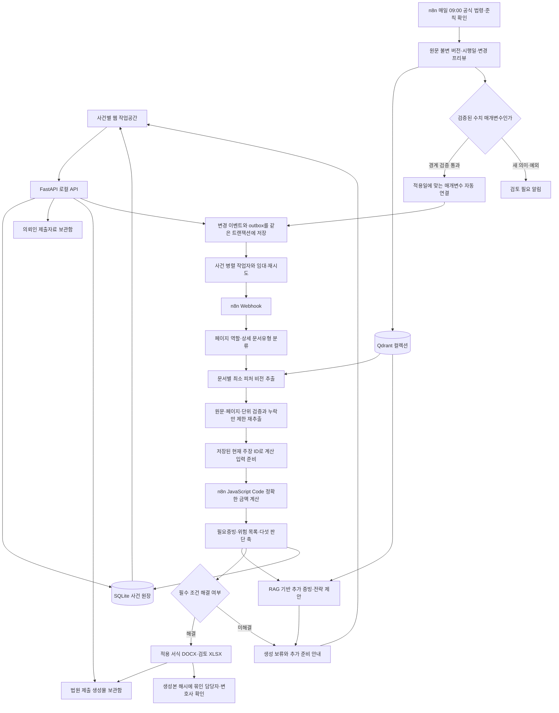
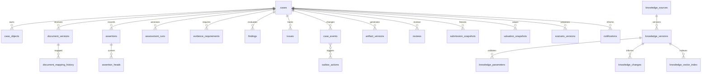

# 현재 구현 아키텍처

2026-10-26. 이 문서는 구현된 모듈과 실행 경계를 설명한다. 실제 법원 인가확률을 예측하는 모델이나 완성된 모든 법률 예외를 의미하지 않는다.

## 실행과 책임

| 모듈 | 책임 |
| --- | --- |
| `app/api.py`, `main.py` | 사건·자료·사실·서식 CRUD, 로컬 경계, 정정 충돌, 다운로드·검수 |
| `app/repository.py` | UUID와 업무 사건번호, SQLite 원장, 주장·생성물·검수 이력, 이벤트/outbox 원자성 |
| `app/storage.py` | `incoming`, `outgoing`, `valuation_evidence` 불변 버전 객체와 해시 검증 |
| `app/runtime.py` | 재평가 대기열, n8n 콜백 토큰, 최신 사건 버전만 채택, 배치 캐시·위험 이력 |
| `app/ai.py`, `promptbook.py` | 분류·유형별 추출, 호출 동시성·배치·토큰·재시도 한도와 비공개 실행 기록 |
| `app/case_engine.py`, `rules/` | 증빙의 대상·기간·대체자료, 미확인/위험 상태, 생성 허용 조건 |
| `workflows/calculators.js` | 실제 n8n Code에서 문자열·고정소수/BigInt로 수행하는 7개 부분 산술 규칙 |
| `app/guidance.py` | 질문 최대 12개를 작은 병렬 작업으로 나눠 관련 사실과 RAG로 추가 준비 제안 |
| `app/knowledge.py`, `knowledge/` | 최초 자료 적재, 공식 원문 변경 조회·버전·시행일·검색·수치 갱신 검증 |
| `app/valuation.py` | 수동 증빙, Car365 인증 안내, 국토부 실거래 비교, 구성된 차량 API |
| `app/rendering.py`, `templates/` | 기본·조건부 법원 서식과 첨부 검토 목록, 편집형 출력 |

사건 작업자 수는 `CASE_CONCURRENCY`(기본 2, 최대 4)다. 실제 모델 호출은 promptbook 설정의 전역·에이전트 동시성 한도를 함께 지킨다. n8n의 HTTP 노드는 문서별 내부 병렬 작업을 호출하며, 계산 자체는 n8n Code 노드에서 실행한다. 문서/법령/프롬프트 본문 전체를 모든 에이전트에 넘기지 않는다. 추출 작업에는 해당 문서유형의 키와 해당 페이지, 판단에는 관련 피처와 질문만 전달한다. 상세한 내부 추론 기록 대신 근거와 확인 결과·다음 행동을 기록한다.

## 데이터 모델

사건 UUID와 `FE-날짜-식별자`를 함께 사용한다. 동일 계약·같은 자산·각 소득원에는 별도 object ID가 있다. 주장은 값·단위·통화·사실 기준일·기록일·원본 문서/쪽/발췌·확인 상태·이전 버전·제출 채택 여부를 저장한다. `REPORTED/EXTRACTED/VERIFIED/DISPUTED/RETRACTED`를 구별하며 AI 추출만으로 검증 완료나 제출 채택이 되지 않는다.

자료 매핑의 대상과 기간, 개별 고용·사업체·임대·이자·배당·연금·급여 등 소득원, 담보·우선·재단·비면책·다툼의 채권 속성을 나눈다. 자산 시가와 법적 청산가치는 별도다. 처분 시나리오는 매각대금·담보상환·비용·후속 현금을 기록하고 실제 재산을 자동 삭제하지 않는다.

입력 변경은 revision을 올리고 현재 생성물·검수를 무효화한다. 실행 중의 편집은 새 재평가를 등록한다. 이전 버전 콜백은 최신 자료를 덮어쓰지 않는다. 작업은 임대·제한 재시도·중복 키를 가지며 서버 재시작 후 재개한다. 추출 성공 배치는 비공개 캐시에 보존한다. 폴링과 재시작으로 사건을 삭제하지 않는다.

## 계산·추가증빙·자산평가·서류 생성

95개 위험 항목은 각 항목의 해당성·근거·자동 구현 여부를 명시한다. 자동 탐지하지 못하는 법률 예외는 확인 요청으로 남는다. 50만원 이상 출금은 법정 기각 기준이 아닌 사용자가 지정한 사무소 확인 정책이며 추출은 계속한다. 체납은 세목·시기·우선/재단/비면책·유예 여부를 확인하고 일괄 기각이나 무조건 완납으로 단정하지 않는다.

필수 미해결·검증되지 않은 핵심 입력·미검토 규칙 판본은 법원 서류 생성을 막는다. 경고만 남은 허용 초안에는 위험 이력과 검토표를 함께 제공한다. 요구 양식의 필수 항목 누락은 생성 전에 확인하고, 생성본 존재·첨부 편철·서명·최종 내용 확인은 별도로 검수한다. 현재 기본 규칙 판본은 **REVIEW_REQUIRED**다. 단일 수치 갱신의 검증이 모든 규칙의 법률 검토 완료를 의미하지 않는다. 검증 자료가 없는 인가 확률 수치를 만들지 않는다.

차량번호만으로 Car365 시세가 조회되는 것으로 가장하지 않는다. 소유자 인증이 필요한 조회는 담당자 작업으로 안내한다. 국토부 API는 키·지역코드·거래월과 비교대상 검토가 필요하며 거래가격을 곧바로 해당 자산의 감정가로 채택하지 않는다. 조회 결과는 근거·조회일·별도 평가 후보로 저장한다.

## 지식 갱신과 평가 분리

Qdrant 컬렉션은 `legal_norms`, `practice_rules`, `case_observations`, `fewshot_success`로 구분한다. 검색 전에 시행일·원문 권한·테넌트·사건·자료 묶음 해시를 거른다. 검색 결과는 최대 3개이며 긴 원문 전체를 주입하지 않는다. 성공사례 컬렉션은 실제 검토된 성공사례가 아직 없어 비어 있다. 벡터 저장소를 사용할 수 없으면 진단용 문자열 검색임을 명시한다.

자동 계산 갱신은 현재 `KR.579.DEBT_LIMITS`의 검증된 두 한도 매개변수에 한정한다. 새 의미·예외·모델 생성 코드는 자동 실행하지 않는다. 원문 변경과 시행일·수치 경계 검증 이력은 보존하고, 과거 평가·생성물·검수 해시는 수정하지 않는다. 일일 스케줄은 로컬 n8n 실행 중에 동작한다.

샘플은 의뢰인 증빙 92쪽만 물리적으로 분리해 생성 입력으로 넣는다. 법원 제출 정답 24쪽과 행정자료 2쪽은 생성기의 이미지·OCR·RAG·few-shot에서 제외한다. 평가 기준 227개는 별도로 고정되어 있다. 최초 엄격 평가 결과는 채점 가능 212개 중 7개 일치였다. 리팩토링의 단위/합성 검증은 이 실제 문서 품질 평가를 대신하지 않는다.

## 저장소와 향후 연동

`.runtime/firmengine.sqlite3`는 관계형 원장, `.runtime/storage/cases/{case_id}/incoming|outgoing|valuation_evidence/{version}/`는 불변 객체 보관함이다. `.runtime/sessions/{case_id}/promptbook/`와 `batches/`는 실제 입력·출력·시스템 지시·본문·사용량·재시도 기록이다. 모두 Git 제외 경로다.

`StorageBackend` 인터페이스와 `provider/namespace/key/version/sha256` 참조를 사용하므로 Drive/GCS 객체 어댑터로 교체할 수 있다. 실제 Google Workspace 인증·동기화·다중 사용자 권한은 아직 구현하지 않았다. 현재 웹 API는 로컬 전용이며 운영용 사용자 인증·권한 서비스는 별도다.
